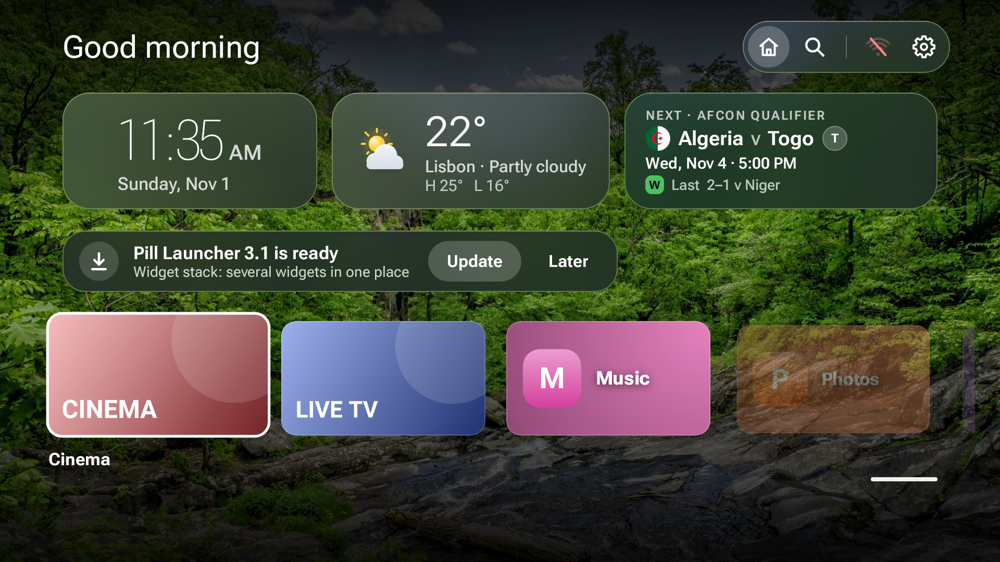
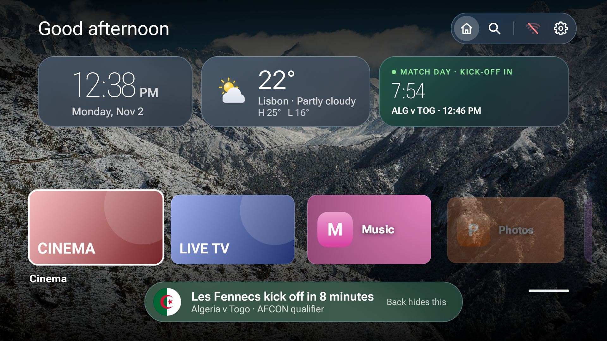

<p align="center">
  
</p>

<h1 align="center">Pill Launcher</h1>

<p align="center">
  <b>A calm, photo-first home screen for Android TV.</b><br>
  Your favourite apps, the time and weather, and a new nature photo every few seconds. No ads, no accounts, no rows of recommendations.
</p>

<p align="center">
  <a href="https://github.com/S1rHades/One-TVOS/releases/download/latest/launcher.apk"></a>
  &nbsp;
  <a href="CHANGELOG.md"></a>
</p>

<p align="center">
  
</p>

## Highlights

- **Just your apps.** The home screen shows only your favourites; everything else waits one press below, as colour cards you can filter by kind (video, music, games).
- **Glass motion.** Pages arrive frosted and come into focus in a wave, the photo softens behind them, and markers glide from one item to the next.
- **A bar for the rest.** A glass bar at the top right leads to Home, Search, the Internet page and Settings, and stays in the same place on every page.
- **Tinted by the photo.** Glass, card edges and the glow under the app you're on take a little of each photo's own colour, changing slowly with the slideshow.
- **Widgets that open up.** Up to four frosted-glass cards across the top, or more in a widget stack that takes turns. OK on the clock, weather, football or headlines card opens a full page for it, and a goal for your team lights the football card up.
- **Updates itself.** A newer version on GitHub shows as a card on the home screen; one press downloads and installs it.
- **Built for the remote.** Focused apps lift and get a crisp white ring, and every action is one or two presses of the D-pad.
- **Light on the TV.** One small app, written in Jetpack Compose, with no background services and no tracking.

Ideas shown as mockups and passed over are listed in [docs/PLANNED.md](docs/PLANNED.md).

## A tour

### Home screen

A greeting for the time of day sits above the widgets (the clock and weather cards say the date and place). Your favourites run along the bottom, and the photo behind them changes every few seconds, cross-fading to the next only once it has loaded, so it never flashes.

Favourites can scroll in one row or wrap onto more rows (**Settings → Favorites row → Layout**), as big banners or small icons.

<table>
  <tr>
    <td width="50%"><br><sub><b>Scroll</b>: one row that slides along as you move.</sub></td>
    <td width="50%"><br><sub><b>Wrap</b>: every favourite at once, on as many rows as it takes.</sub></td>
  </tr>
  <tr>
    <td width="50%"><br><sub><b>Reorder</b>: app menu → Move, then Left / Right, then OK.</sub></td>
    <td width="50%"><br><sub><b>First launch</b>: a hint shows how to fill Favorites.</sub></td>
  </tr>
</table>

### The bar and glass motion

The bar at the top right holds **Home** and **Search**, then a divider, **Wi-Fi** (the Internet page) and **Settings**. Press **Up** from the widgets to reach it, and **Down** to go back to the widgets (or the first favourite, or All apps when you are there). A white marker glides to the icon you're on, and a softer marker stays on the section you're in. The Wi-Fi icon turns red when the TV is offline. The bar stays in the same place on every page and panel, which all start below it, and it works from there too: Home closes whatever is open.

Every page opens the same way. The photo behind blurs and dims, the page dissolves in from frosted glass, and its parts come into focus one after another in reading order. Back reverses it. The blur needs Android 12 or later; older TVs get the same timing as a plain fade.

### All apps

Press **Down** from Favorites for every app as a card in its own colour. Chips above the grid show only the video, music or game apps: move to a chip and press **OK**. The kind comes from what each app says about itself, then from its name.

<table>
  <tr>
    <td width="50%"><br><sub><b>All apps</b>: every app, with a star on the ones in Favorites.</sub></td>
    <td width="50%"><br><sub><b>Chips</b>: only the video, music or game apps.</sub></td>
  </tr>
  <tr>
    <td width="50%"><br><sub><b>App menu</b>: hold OK on any app to pin it, move it, see its info or uninstall it.</sub></td>
    <td width="50%"><br><sub><b>Pinned</b>: a short confirmation, and the app joins Favorites.</sub></td>
  </tr>
</table>

**Rename…** in the app menu gives an app a name of your own. It shows everywhere in the launcher, while the app itself keeps its own name; **Use its own name** brings that back. **App info** opens the app's page in the TV's settings, for its storage, permissions and the rest.

<p align="center"></p>

### Search

**Search** in the bar opens a panel that finds any app by name. It opens on a strip of letters: **Left** / **Right** and OK spell a name with no keyboard, the matches narrow as you go, and letters that no app's name continues with are dimmed. **Delete** and **Space** are at the start of the strip. The TV keyboard is still there: **Up** to the search field, then OK.

<p align="center"></p>

### Widgets

Up to four cards across the top: clock, weather, sunrise & sunset, system info, headlines and football. Switch them on and off and reorder them under **Settings → Widgets**. With two on, the cards are roomy; with four, they switch to compact layouts.

<table>
  <tr>
    <td width="50%"><br><sub><b>Two widgets</b>: wide cards with room for the full place and sky.</sub></td>
    <td width="50%"><br><sub><b>Four widgets</b>: the most at once, in compact layouts.</sub></td>
  </tr>
</table>

<table>
  <tr>
    <td width="50%"><br><sub><b>Widget settings</b>: OK switches a widget; Left / Right moves it.</sub></td>
    <td width="50%"><br><sub><b>Weather icons</b>: drawn by the app, with a little movement (sun rays turn, rain falls).</sub></td>
  </tr>
</table>

#### Widget stack

The widget stack is a widget that holds others and takes turns between them: every 8 seconds the next slides up from below, and dots down its right edge show which is on. With the stack focused, **Up** / **Down** flips through by hand (**Down** from the last goes on to Favorites) and OK opens the page of the one showing. It is as wide as the widest widget in it.

<p align="center"></p>

Choose what goes in it under **Settings → Widgets → Widget stack**: OK adds or removes a widget, and holding OK on one, then **Left** / **Right**, moves it, the same way as moving a favourite. While the Widgets pages are open, the home screen steps aside to the left of the panel, undimmed, as a live preview: the stack there shows the widget you're on, and each change shows at once.

<p align="center"></p>

OK on the clock card opens the clock page: the time with seconds, the date in the Gregorian and Islamic calendars, the week and day of the year, this month, and world clocks.

<p align="center"></p>

The weather, football and headlines pages are described in their own sections below.

### Internet

**Wi-Fi** in the bar opens the Internet page: a speed test and a way into the TV's network settings. See [Internet speed test](#internet-speed-test).

<p align="center"></p>

### Settings

**Settings** in the bar opens a floating card for the photos, widgets, favourites, idle screen, how the launcher becomes the home screen, and the TV's own settings. **TV & system** frees memory and opens the TV's network, display, sound, storage and update screens.

<table>
  <tr>
    <td width="50%"><br><sub><b>Settings</b>: each row shows its current choice.</sub></td>
    <td width="50%"><br><sub><b>TV & system</b>: the TV's own screens, one press away.</sub></td>
  </tr>
</table>

### Updates

When a newer Pill Launcher is on GitHub, a card above Favorites says so, with the first line of what's new. **Update** downloads it with a progress bar, then Android asks you to confirm the install; settings and favourites stay, since every release is signed with the same key. **Later** hides the card until the next version. The first time, Android asks to allow Pill Launcher to install apps.

**Settings → Updates** checks by hand, installs from there with the same progress, lists what's new, and turns off the check every few hours.

<table>
  <tr>
    <td width="50%"><br><sub><b>Update card</b>: above Favorites until you update or choose Later.</sub></td>
    <td width="50%"><br><sub><b>Settings → Updates</b>: check, install and what's new.</sub></td>
  </tr>
</table>

### Idle screen

After a while without a key press (two minutes by default, under **Settings → Idle screen**), everything but the widgets fades away and the photo slowly zooms. Nothing else is on the photo: no captions or credits. Any key brings the home screen back.

<p align="center"></p>

## Install

1. On the TV, install **Downloader** (by AFTVnews) from the Play Store.
2. Open it and enter `https://github.com/S1rHades/One-TVOS/releases/download/latest/launcher.apk`.
3. Allow Downloader to install unknown apps when Android asks, then choose **Install**.

To make it your home screen, open **Settings** (the gear) → **Home & startup** → **Default home screen**. Android asks you to confirm; after that, Home and closing or killing any app bring you back to Pill Launcher.

Many TVs, most Google TV devices among them, don't let any app replace the home screen. On those, use **Settings → Home & startup → Home button helper**: it opens Accessibility settings, where you turn on **Pill Launcher Home button**. Whenever the TV's own home screen opens (Home pressed, an app closed or killed), the helper brings Pill Launcher straight back. It only checks which app came to the front, never what is on screen. On Android 13 and later, a sideloaded app's accessibility switch may be greyed out at first: open **Settings → Apps → Pill Launcher**, choose **⋮ → Allow restricted settings**, then turn it on.

Until one of these is set up, the home screen shows a reminder with a **Set up** button, which tries the first way and then the second. **Not now** hides it.

<p align="center"></p>

If a TV allows neither, a computer with [ADB](https://developer.android.com/tools/adb) connected to the TV can make Pill Launcher the home screen:

```
adb shell cmd package set-home-activity app.pill.launcher/.MainActivity
```

On TVs that ignore that command, turning off the stock launcher works too (turn it back on with `pm enable`). On Google TV, run `adb shell pm disable-user --user 0 com.google.android.apps.tv.launcherx`; on Android TV, run `adb shell pm disable-user --user 0 com.google.android.tvlauncher`.

The `latest` release is rebuilt automatically every time `main` changes, so installing it again always gets you the newest version.

Every version also keeps its own release, named after it (**Pill Launcher 3.1.2**, tag `v3.1.2`, file `pill-launcher-3.1.2.apk`), so an older version stays downloadable: `https://github.com/S1rHades/One-TVOS/releases/download/v3.1.2/pill-launcher-3.1.2.apk`. The newest is titled **Pill Launcher 3.1.2 (latest)** and holds the same file under its version's name, plus `launcher.apk`, the copy behind the link above that never changes. Releases from 2.5 on are kept; older ones weren't saved.

### Uninstalling

From the launcher: **Settings → TV & system → Uninstall Pill Launcher**, then OK twice and confirm.

If the launcher won't open, use the TV's own **Settings → Apps → Pill Launcher → Uninstall**. Either way, the TV's own home screen takes over afterwards.

## Using it

| To | Press |
| --- | --- |
| Open an app | **OK** |
| Reach the bar at the top right, and leave it | **Up** from the widgets; **Down** goes back to them |
| See all apps | **Down** from Favorites |
| Show only video, music or game apps | **Down** to the chips above All apps, **Left** / **Right**, then **OK** |
| Find an app | **Search** in the bar, then letters from the strip (**Left** / **Right**, OK), or **Up** to the field for the keyboard |
| Test the internet speed, or open Wi-Fi settings | **Wi-Fi** in the bar, then **Start test** or **Network settings** |
| See if a VPN is on | The Internet page says so |
| Change how favourites are laid out | **Settings → Favorites row → Layout**: Scroll or Wrap |
| Banners or icons for favourites | **Settings → Favorites row → Tile style** |
| Wake the idle screen | Any key |
| App menu: pin / unpin, move, app info, uninstall | Hold **OK** for half a second, or press **Menu** (☰) |
| Reorder favourites | App menu → **Move**, then **Left** / **Right**, and **OK** when done |
| Open settings | **Settings** (the gear) in the bar, then **OK** |
| Rename an app | App menu → **Rename…**, then **Save** |
| Flip through a widget stack | With it focused, **Up** / **Down** |
| Choose and order a widget stack's widgets | **Settings → Widgets → Widget stack**: OK adds or removes one; hold OK, then **Left** / **Right**, moves it |
| Install a newer version | **Update** on the card above Favorites, or **Settings → Updates** |
| Change how often the photo changes, or the weather unit | In settings, **Left** / **Right** on that row |
| Turn widgets on or off | **Settings → Widgets**, **OK** on a widget (up to four at once) |
| Reorder widgets | **Settings → Widgets**, **Left** / **Right** on a widget that's on |
| Open the clock page, the weather dashboard, the football page or the news page | Go up to that widget, then **OK** (**Back** closes it) |
| Pick a day on the weather dashboard | **Left** / **Right** |
| Pick a team on the football page, or a story on the news page | **Up** / **Down** |
| Follow more teams, or change match day | **Settings → Widgets → Football teams** |
| Choose headline topics | **Settings → Widgets → Headlines** |
| Hide the kick-off reminder | **Back** (it also goes by itself after 30 seconds) |
| Free up memory, or open the TV's network, display, sound or update screens | **Settings → TV & system** |
| Uninstall Pill Launcher (OK twice, then confirm) | **Settings → TV & system → Uninstall Pill Launcher** |
| Close a page or settings | **Back** |

Settings and favourites are saved on the TV and survive restarts and updates.

### Weather and forecast

The widget finds the TV's approximate location from its internet address with [GeoJS](https://www.geojs.io/) and gets the forecast from [Open-Meteo](https://open-meteo.com/), or from [MET Norway](https://api.met.no/) if Open-Meteo can't be reached. None of them needs an account or key. It refreshes every 30 minutes. Choose °C or °F in settings. Turn off both the Weather and the Sunrise & sunset widgets, and the launcher contacts none of these services. If the weather can't load, Settings shows why under the Weather widget's row. Sunrise and sunset are worked out on the TV from the same location.

OK on the weather card opens the weather dashboard:

- **Now**: "feels like" (with a line for the next day's temperatures), humidity, wind with its direction, and the UV index.
- **7 days**: each day's range as a bar. **Left** / **Right** picks a day, and its bar lights up in the photo's colour with the range above it.
- **Today**: the next sunrise or sunset, when rain is likely, the warmest or coolest hour to come, and tomorrow.

<p align="center"></p>

MET Norway gives no "feels like", UV or chance of rain, so with it the page shows the expected rain in mm instead. The last reading is saved on the TV, so the card and the dashboard show at once after a restart and while offline.

### Football

The football widget follows Algeria's men's team (always first) and up to five more teams you add under **Settings → Widgets → Football teams**: search for a club or a country. The card takes turns between them every 20 seconds, each with its next fixture (competition, crests and kick-off in the TV's time zone) and latest result, marked W, D or L. During a match it shows **LIVE** and the score.

OK on the card opens the football page in three columns: your teams (**Up** / **Down** picks one); the next match with a countdown and the latest result; and the team's crest, league place and points, with the top of its league table.

<p align="center"></p>

**Goals and wins**: when a team you follow scores, its card flashes green, the score flips to the new one, and the last line says "Goal · Algeria 78'" (the minute is worked out from kick-off, since the free data has no clock). A win ends at full time in a short burst of confetti inside the card. A widget stack holding the football card brings it forward. The data refreshes every 3 minutes around a match, so the card lights up a little after the real goal. Every line stays on one line inside the card: long team names give way with an ellipsis before the score does. Nothing moves on the idle screen.

<p align="center"></p>

**Match day**: on the day a followed team plays, the card stays on that team and counts down to kick-off, and ten minutes before, a banner says so (it never takes focus: **Back** hides it, and it goes by itself after 30 seconds). Choose all teams, Algeria only, or off under **Football teams → Match day**.

<table>
  <tr>
    <td width="50%"><br><sub><b>Match day</b>: the football card counts down to kick-off.</sub></td>
    <td width="50%"><br><sub><b>Kick-off reminder</b>: ten minutes before, a banner that never gets in the way.</sub></td>
  </tr>
  <tr>
    <td width="50%"><br><sub><b>Follow teams</b>: search for a club or country and add up to five beside Algeria.</sub></td>
    <td width="50%"></td>
  </tr>
</table>

The data comes from [TheSportsDB](https://www.thesportsdb.com/)'s free API, with no account needed. The free data has one next match and one latest result per team, and only the top five of a table. Many TVs can't reach TheSportsDB (its Cloudflare protection turns some away), so the **Fixtures mirror** workflow (`.github/workflows/fixtures.yml`, `.github/scripts/mirror.py`) keeps copies on the `fixtures-data` branch for Algeria (every 30 minutes) and for about 120 clubs and national teams listed in `.github/mirror/teams.txt` (each every few hours, and every 30 minutes around its matches). Search shows which teams work on any network; others need the TV to reach TheSportsDB directly. To add a team for every network, add its name to `teams.txt`. The widget refreshes every 30 minutes, and every 3 minutes around a match. Each team's last good copy is saved on the TV.

### Headlines

The headlines widget shows one story at a time from [Al Jazeera English](https://www.aljazeera.com/) and [RT English](https://www.rt.com/), newest first, a new one every 20 seconds.

OK opens the news page: every picked headline in a list on the left, and the story beside it, with its topic, source, age and summary. **Up** / **Down** moves through the list, and the story dissolves to the next.

<table>
  <tr>
    <td width="50%"><br><sub><b>Headlines card</b>: one story at a time, picked by topic.</sub></td>
    <td width="50%"><br><sub><b>News page</b>: the whole list, with the story beside it.</sub></td>
  </tr>
</table>

Neither site has feeds by topic, so the launcher picks stories itself, by section and by words in the headline and summary, for the topics on under **Settings → Widgets → Headlines**: Algeria, Russia and International politics by default, plus Africa & Middle East, Economy and Sport. If nothing matches, it shows the newest stories as top stories.

Al Jazeera is read from its RSS feed, or from a copy the Fixtures mirror keeps on `fixtures-data` (headline, link, date and short summary only). RT is only ever read directly by the TV: it is banned from distribution in the EU and blocked in some other countries, so it is never copied to GitHub. Where it is blocked, Settings says "Not available on this network" and the widget carries on with Al Jazeera.

### Internet speed test

**Wi-Fi** in the bar opens the Internet page (pictured [above](#internet)). **Start test** measures the connection against [Cloudflare's speed test](https://speed.cloudflare.com/) service:

1. **Ping**: the quickest of a few tiny requests, in milliseconds.
2. **Download**: about seven seconds of downloading. The dial follows the speed live.
3. **Upload**: about five seconds of uploading.

When it's done, a chip says in plain words what the speed is good for: 4K streaming (25 Mbps or more), HD streaming (10 or more), standard video (4 or more), or slow. The results card shows all three numbers, the network (with its signal on Wi-Fi, and whether a VPN is on) and when the last test ran. The last result is saved on the TV. Nothing is measured until you press **Start test**, and Back stops a test at once. **Network settings**, at the top left of the page, opens the TV's own Wi-Fi and network screen.

### Online photos

By default the slideshow shows a new set of 24 landscape photos each day from [Wikimedia Commons' Featured Pictures](https://commons.wikimedia.org/wiki/Commons:Featured_pictures) (mountains, lakes, forests, waterfalls and coasts). The **Photo feed** workflow (`.github/workflows/photo-feed.yml`, `.github/scripts/photo_feed.py`) picks them each morning, resizes them to 1920×1080 and publishes them with their credits on the `photos-data` branch. The TV reads them from `raw.githubusercontent.com`. The photos are freely licensed (mostly CC BY-SA): **Settings → Background** shows the photo on screen's full credit and licence. Offline, the TV uses the last set it saw and the built-in photos.

### Your own photos

The twelve built-in nature photos (used offline, or with **Online nature photos** off) are part of the app (`app/src/main/assets/photos`), so they show even without internet. To change them, edit the Lorem Picsum ids in `BackgroundSources` (`app/src/main/java/app/pill/launcher/ui/BackgroundSlideshow.kt`) and in `.github/workflows/photos.yml`, then run the **Bundle photos** workflow. `BackgroundSources` also accepts direct `https://` image links.

<sub>Screenshots are rendered at 1920×1080 from the app's own interface code by <code>.github/workflows/screenshots.yml</code>. The app names and icons in them are stand-ins; on your TV you'll see your installed apps. Photos: <a href="https://picsum.photos">Lorem Picsum</a> (Unsplash licence).</sub>

## Development

You need JDK 17 and the Android SDK (API 34). Android Studio works, or from the command line:

```
gradle assembleDebug                                   # app/build/outputs/apk/debug/app-debug.apk
gradle :app:testDebugUnitTest --tests '*Screenshots*'  # re-render docs/screenshots
```

**Builds are automated.** `.github/workflows/build.yml` builds the APK for every pull request and push; builds of `main` publish a release for the version in `app/build.gradle.kts` (for example `v3.1.2`) and replace the `latest` release. `.github/workflows/screenshots.yml` re-renders the README screenshots at 1920×1080 and commits them; it runs on pushes that change the app, or from the Actions tab. `.github/scripts/check_readme.py` fails the build when this README falls behind the app: a picture that doesn't exist, a rendered screenshot that isn't shown, a source file missing from Architecture, or a version it doesn't name.

<details>
<summary><b>Architecture</b></summary>

```
app/src/main/java/app/pill/launcher/
  MainActivity.kt        launcher activity: loads apps, opens them, keeps pins and settings
  AppModel.kt            lists launchable apps with their icons and kinds (video, music, games)
  LauncherSettings.kt    settings and pinned apps in SharedPreferences
  Weather.kt             location and forecast lookup, condition names and units
  Widgets.kt             the widget kinds, the four-widget limit, toggling and reordering
  Football.kt            followed teams' fixtures and tables from TheSportsDB or the mirror
  MatchDay.kt            match-day countdown and the kick-off reminder
  News.kt                headlines from Al Jazeera and RT, picked by topic
  SpeedTest.kt           ping, download and upload against Cloudflare's speed test
  Updates.kt             newer releases from GitHub: check, download, install, and the installer's answer
  Moments.kt             goals and wins noticed between football fetches, and the match minute
  PhotoFeed.kt           the daily Wikimedia photo set and its credits
  Daylight.kt            sunrise and sunset from latitude and longitude
  HomeSetup.kt, HomeRedirectService.kt   becoming the home screen, and the Home button helper
  BootReceiver.kt        opens the launcher when the TV starts, if Autostart is on
  ui/
    LauncherScreen.kt    the home screen: greeting, widgets, favourites, All apps below, page scrolling
    NavBar.kt            the bar at the top right (Home, Search, Wi-Fi, Settings) and the greeting
    RenameDialog.kt      Rename… from the app menu
    UpdateCard.kt        the update card above Favorites, its progress bar and download icon
    Motion.kt            glass motion: durations, easing, dissolve, the reading-order wave, glide
    Overlay.kt           full-screen pages: blurred backdrop, open and close motion
    PageParts.kt         shared page title, cards and sparkline
    AllApps.kt           kind chips and colour app cards
    ClockPage.kt, ForecastPage.kt, FootballHub.kt, HeadlinePage.kt, InternetPage.kt   the pages
    WidgetCards.kt       the header's glass widget cards and their row
    WeatherWidget.kt     the weather card's content, with drawn condition icons
    FavoritesRow.kt, AppTile.kt, BannerTile.kt   the favourites row and its tiles
    SearchPanel.kt, SettingsPanel.kt, AppMenu.kt   panels over the home screen
    HomePrompt.kt        the Set up reminder until Pill Launcher is the home screen
    NetworkStatus.kt     how the TV is connected, the Wi-Fi signal and whether a VPN is on
    TileInput.kt         OK, long-press and Menu handling shared by tiles and cards
    SettingsPill.kt      the gear icon
    BackgroundSlideshow.kt  photo cross-fade, tint and the readability scrim
    Glass.kt, Theme.kt, Squircle.kt   frosted glass, shared colours and spacing, the tile shape
app/src/test/.../Screenshots.kt   Robolectric + Roborazzi renders for this README
```

The screen is laid out in dp for a 960×540 dp canvas (a 1080p TV at xhdpi), with 48 dp and 27 dp margins to stay inside the overscan-safe area.

</details>
