<p align="center">
  
</p>

<h1 align="center">Pill Launcher</h1>

<p align="center">
  <b>A calm, photo-first home screen for Android TV.</b><br>
  Your favourite apps, the time and weather, and a new nature photo every few seconds. No ads, no accounts, no rows of recommendations.
</p>

<p align="center">
  <a href="https://github.com/S1rHades/One-TVOS/releases/download/latest/launcher.apk"></a>
  &nbsp;
  <a href="CHANGELOG.md"></a>
</p>

<p align="center">
  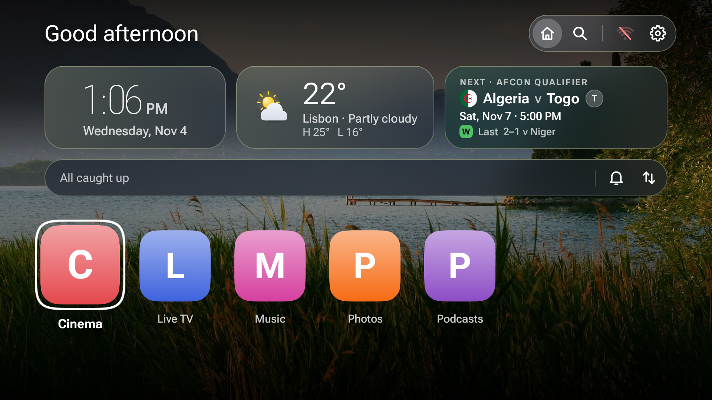
</p>

## Highlights

- **Just your apps.** The home screen shows only your favourites; everything else waits one press below, as colour cards you can filter by kind (video, music, games).
- **Glass motion.** Pages arrive frosted and come into focus in a wave, the photo softens behind them, and markers glide from one item to the next.
- **A bar for the rest.** A glass bar at the top right leads to Home, Search, the Internet page and Settings, and stays in the same place on every page.
- **Tinted by the photo.** Glass, card edges and the glow under the app you're on take a little of each photo's own colour, changing slowly with the slideshow.
- **Widgets that open up.** Up to four frosted-glass cards across the top, or more in a widget stack that takes turns. OK on the clock, weather, football or headlines card opens a full page for it, and a goal for your team lights the football card up.
- **A notification bar.** Under the widgets, as wide as them: the newest notification (a new version, a goal, a file from your phone, another app's) with a bell that opens them all. One press installs an update from there.
- **Files from your phone.** Scan a code on the TV and send photos, videos, apps or documents from your phone's browser, with nothing to install; they open on the TV in one press.
- **Apps and websites from a link.** Give the launcher a link, typed on the TV or sent from your phone: a website becomes a tile that opens full screen with a pointer for the remote, an `.apk` is downloaded and installed, and a Play Store link opens the app's page. New ones join Favorites.
- **Built for the remote.** Focused apps lift and get a crisp white ring, and every action is one or two presses of the D-pad.
- **In English, French or Arabic.** The launcher follows the TV's language or one you choose, and in Arabic the whole screen is laid out right to left.
- **Light on the TV.** One small app, written in Jetpack Compose, with no tracking. Behind another app it stays out of the way: the slideshow waits, the app list is read again only when an app is installed or removed, and file sharing stops unless you ask it to keep going. Only the widgets' data keeps refreshing, so they're up to date the moment you come back.

Ideas shown as mockups and passed over are listed in [docs/PLANNED.md](docs/PLANNED.md).

## A tour

### Home screen

A greeting for the time of day sits above the widgets (the clock and weather cards say the date and place), and the [notification bar](#notifications) runs under them. Your favourites run along the bottom, and the photo behind them changes every few seconds, cross-fading to the next only once it has loaded, so it never flashes.

Favourites are app icons, in one row that scrolls or wrapped onto more rows (**Settings → Home screen → Favorites row → Layout**). **Order** there can put them **by use** instead: the app you open most goes first and the next most opened last, the places people find quickest, with the rest in your own order.

<table>
  <tr>
    <td width="50%">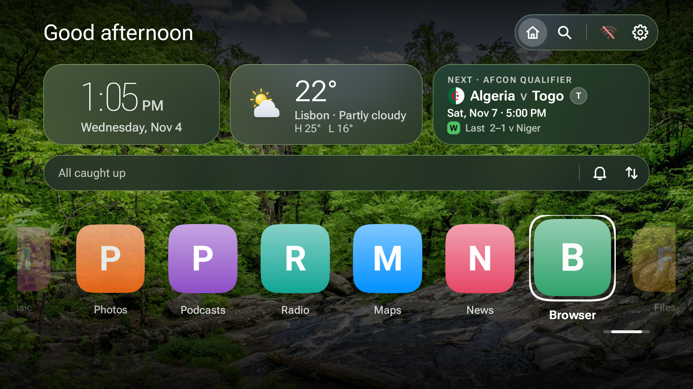<br><sub><b>Scroll</b>: one row that slides along as you move.</sub></td>
    <td width="50%">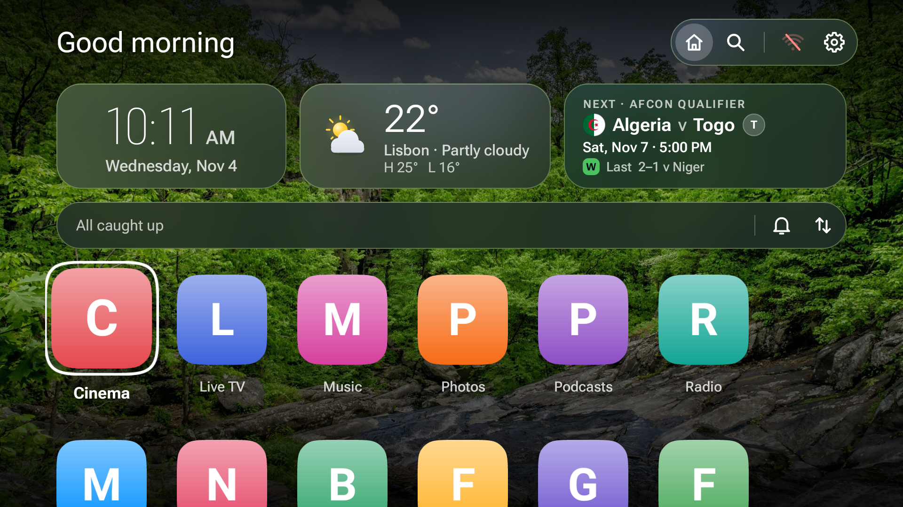<br><sub><b>Wrap</b>: every favourite at once, on as many rows as it takes.</sub></td>
  </tr>
  <tr>
    <td width="50%">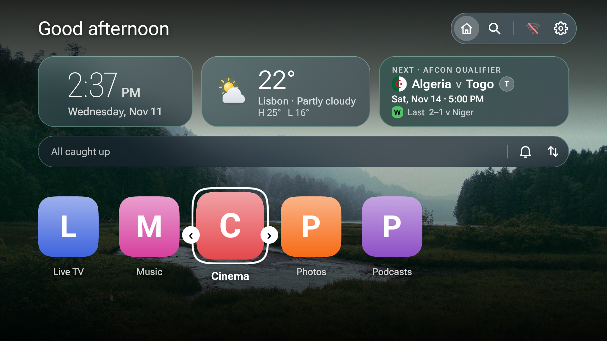<br><sub><b>Reorder</b>: app menu → Move, then Left / Right, then OK.</sub></td>
    <td width="50%">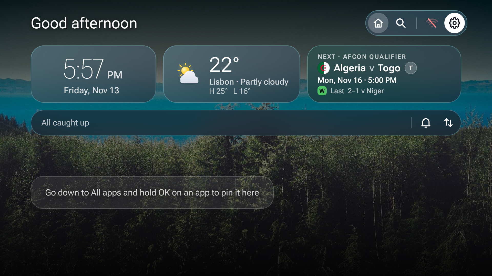<br><sub><b>First launch</b>: a hint shows how to fill Favorites.</sub></td>
  </tr>
</table>

### The bar and glass motion

The bar at the top right holds **Home** and **Search**, then a divider, **Wi-Fi** (the Internet page) and **Settings**. Press **Up** from the widgets to reach it, and **Down** to go back to the widgets (or the notification bar when no widget takes focus, or All apps when you are there). A white disc follows focus along the bar, setting off from the section you're in and fading where it is when you leave the bar, while a grey disc stays on the section you're in. Press **OK** on an item and the grey disc glides from the section you were in into it, under the white one, as its page opens; the page takes focus straight away, without it stopping on the bar first. Settings opens over whatever page is showing, and Back returns to it. The Wi-Fi icon turns red when the TV is offline. The bar stays in the same place on every page and panel, which all start below it, and it works from there too: Home closes whatever is open.

Every page opens the same way. The photo behind blurs and dims, the page dissolves in from frosted glass, and its parts come into focus one after another in reading order. Back reverses it. The blur needs Android 12 or later; older TVs get the same timing as a plain fade.

### All apps

Press **Down** from Favorites for every app as a card in its own colour. Chips above the grid show only the video, music or game apps: move to a chip and press **OK**. The kind comes from what each app says about itself, then from its name.

<table>
  <tr>
    <td width="50%">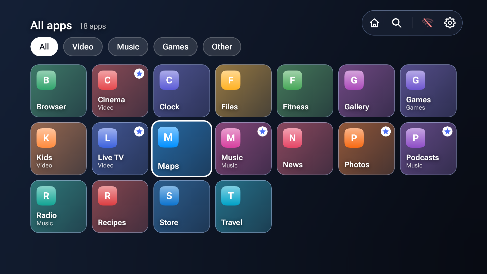<br><sub><b>All apps</b>: every app, with a star on the ones in Favorites.</sub></td>
    <td width="50%">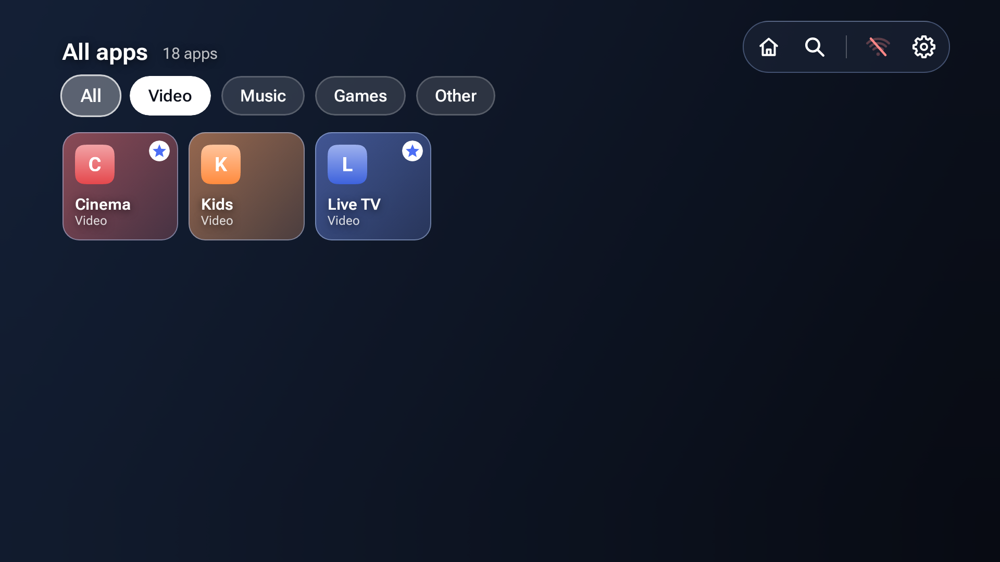<br><sub><b>Chips</b>: only the video, music or game apps.</sub></td>
  </tr>
  <tr>
    <td width="50%">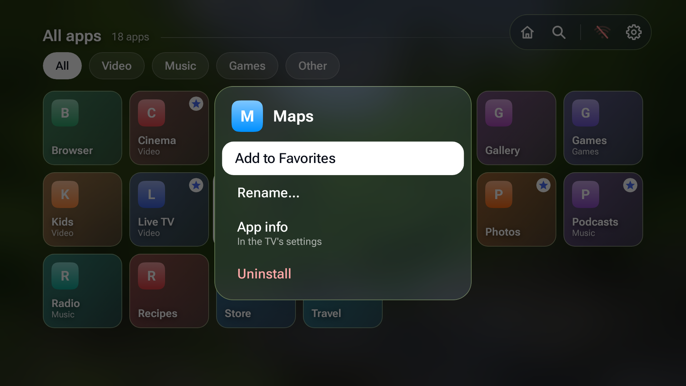<br><sub><b>App menu</b>: hold OK on any app to pin it, move it, see its info or uninstall it.</sub></td>
    <td width="50%">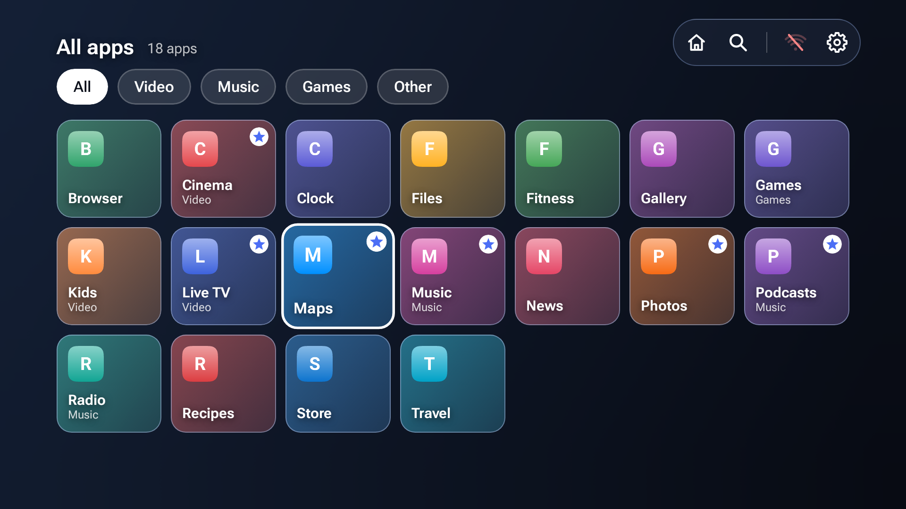<br><sub><b>Pinned</b>: a short confirmation, and the app joins Favorites.</sub></td>
  </tr>
</table>

**Rename…** in the app menu gives an app a name of your own. It shows everywhere in the launcher, while the app itself keeps its own name; **Use its own name** brings that back. **App info** opens the app's page in the TV's settings, for its storage, permissions and the rest.

<p align="center">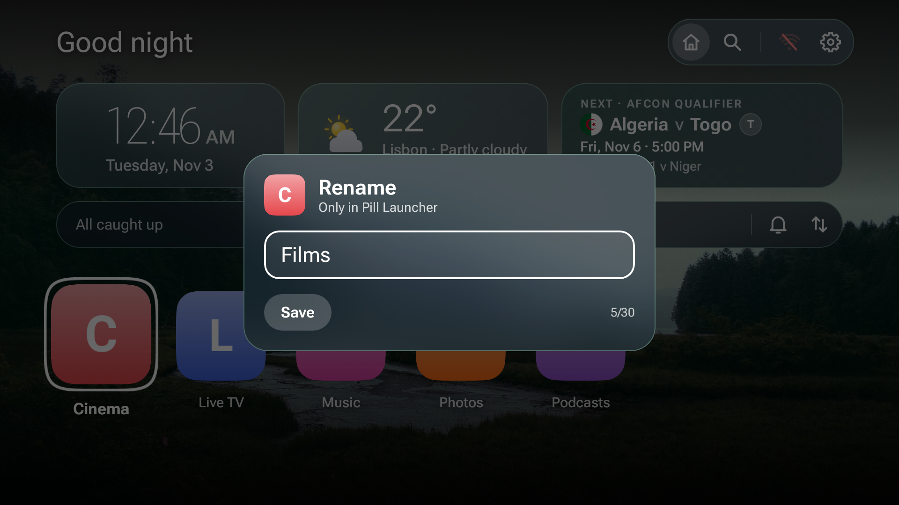</p>

### Apps and websites from a link

**Settings → Home screen → Add an app or website** adds a tile from a link. Type the link in the field (**OK** opens the TV's keyboard), or send it from your phone, which is easier: the phone's Files page has **Send a link**, the link arrives in the notification bar, and **OK** on it opens this page with the link already checked. **Check this link** works out what the link is:

- **A website** comes with its name and icon from the site, and **Add to the home screen** puts it in Favorites as a tile of its own. It is in All apps and Search too, and holding **OK** on it renames it, moves it or removes it (**Remove shortcut**).
- **An app**, a link to an `.apk` file (a GitHub release, say), shows its size. **Download and install** downloads it, showing how far it has got (**OK** stops it), and hands it to Android's install screen, which asks you to confirm. The first time, Android asks you to allow Pill Launcher to install apps. Once it is installed, it joins Favorites.
- **A Play Store link** opens the app's page in the TV's Play Store, and the app joins Favorites once you install it there.

Below are the web shortcuts made so far; **OK** twice on one removes it.

<table>
  <tr>
    <td width="50%">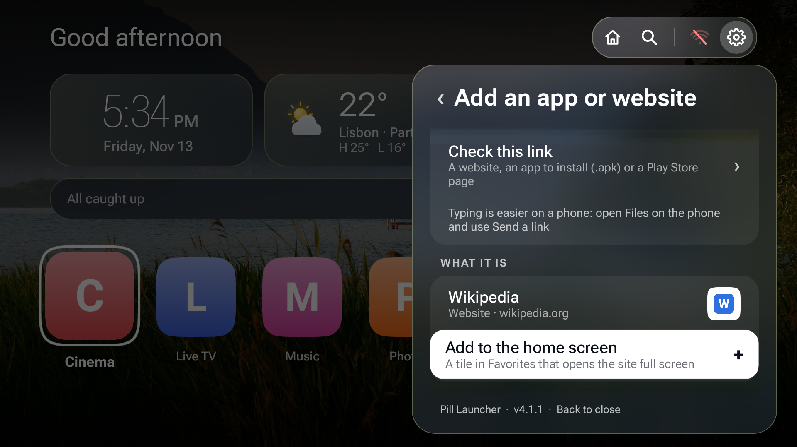<br><sub><b>Add an app or website</b>: a checked link and what OK on it does.</sub></td>
    <td width="50%">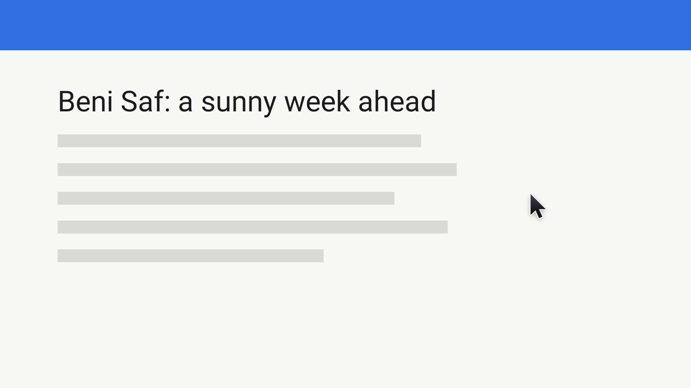<br><sub><b>A website</b>: the arrows glide the pointer and OK clicks; the margin keeps it clear of edges a TV cuts off.</sub></td>
  </tr>
</table>

**The web viewer.** A website opens full screen, with no browser bar, like an app. The arrows move a pointer and **OK** clicks where it is. It glides rather than jumps: held, it sets off slowly enough to land on a small link and smoothly speeds up to cross the screen in about a second, a quick tap moves it a little, and at the edge of the screen the page scrolls instead. The page keeps the same margin as the launcher's own screens, since many TVs (older ones especially) cut off the edges of the picture. **Back** goes back a page, and leaves from the site's first page; **Home** leaves it waiting in the TV's recent apps. Holding **OK** (or pressing **Menu**) opens the viewer's menu: **Reload**, **Text size** (100% to 175%), **Page size** (100% down to 67%, so a page made for a wider screen fits), **Use the whole screen** (for a TV that shows the picture's edges), **Jump between links** for pages made for a remote (the arrows then go from link to link), **Ask for the TV version** (some sites have a layout made for TVs; YouTube's is at `youtube.com/tv`) and **Back to the home screen**. Each site keeps these choices and stays signed in. A video's full-screen button fills the screen, and **Back** leaves full screen. When a page offers an app to download, it arrives in the notification bar to install as above.

<p align="center">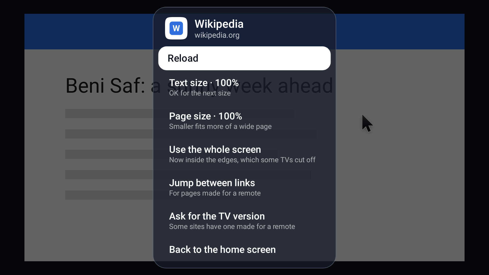</p>

**What it can't do.** Streaming services such as Netflix usually refuse to play inside an app's built-in browser: install their TV apps instead (a Play Store link does that). A plain `http://` address is opened as `https://`, since the TV only loads secure pages. Some sites stay awkward with a remote even with the pointer.

### Search

**Search** in the bar opens a panel that finds any app by name. It opens on a strip of letters: **Left** / **Right** and OK spell a name with no keyboard, the matches narrow as you go, and letters that no app's name continues with are dimmed. **Delete** and **Space** are at the start of the strip. The remote's search key opens it too. Search ignores accents, capitals and hyphens ("ain" finds "Aïn"), and when nothing matches it allows one slip in a word of four letters or more, so "recipies" still finds Recipes. The TV keyboard is still there: **Up** to the search field, then OK.

<p align="center">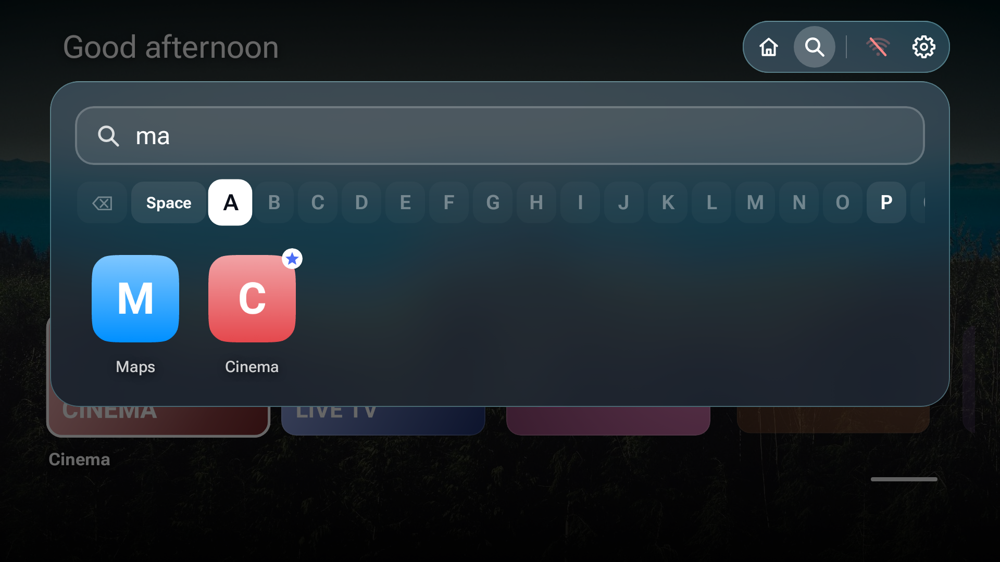</p>

### Widgets

Up to four cards across the top: clock, weather, sunrise & sunset, system info, headlines, football and prayer times. Each card lays out what it has for the room it gets, whether one widget is on or four: every line has fuller and shorter versions, most important first, and the card shows the fullest one that fits. So a single wide weather card reads "Beni Saf · Partly cloudy" with "H 25°   L 16°", and a narrow one "Beni Saf" with "25° / 16°"; a football card shortens "Next · AFCON Qualifier" to "Next" and team names to their codes. Nothing is ever cut with "…": a line that isn't needed goes instead. Switch them on and off and reorder them under **Settings → Widgets**, where the ones that are on sit numbered in their own group, apart from the ones available. **Hold OK** (or press **Menu**) on a card for its own menu: its settings, **Move left** / **Move right**, and **Remove widget**.

<p align="center">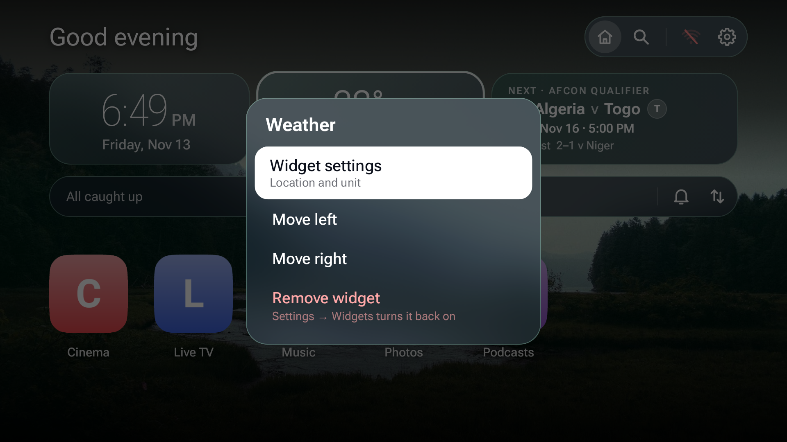<br><sub><b>A widget's menu</b>: hold OK on the card.</sub></p> With two on, the cards are roomy; with four, they switch to compact layouts.

<table>
  <tr>
    <td width="50%">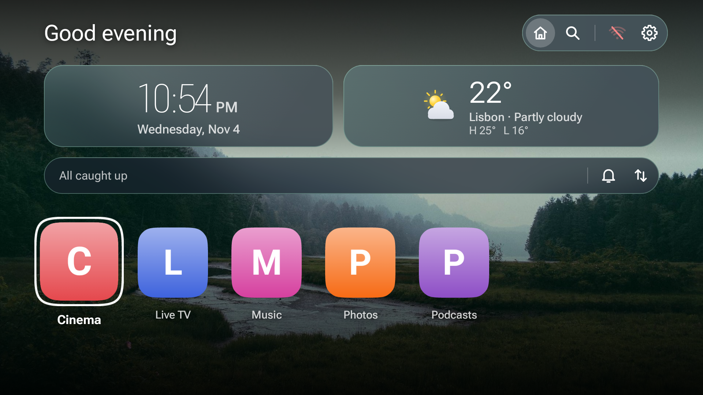<br><sub><b>Two widgets</b>: wide cards with room for the full place and sky.</sub></td>
    <td width="50%">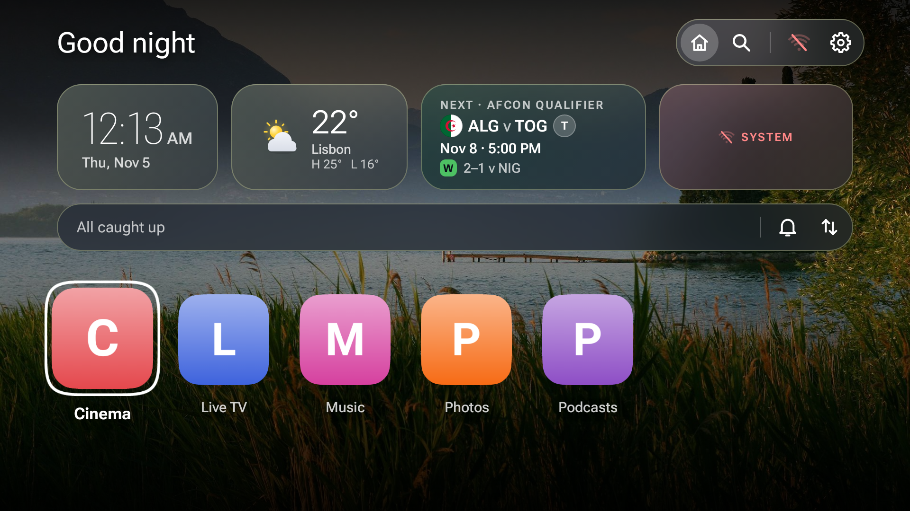<br><sub><b>Four widgets</b>: the most at once, in compact layouts.</sub></td>
  </tr>
</table>

<table>
  <tr>
    <td width="50%">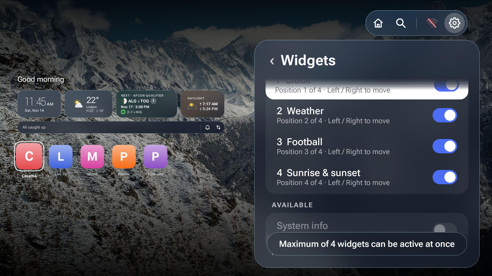<br><sub><b>Widget settings</b>: the four on, then the rest; OK switches a widget, Left / Right moves it.</sub></td>
    <td width="50%"><br><sub><b>Weather icons</b>: drawn by the app, with a little movement (sun rays turn, rain falls).</sub></td>
  </tr>
</table>

#### Widget stack

The widget stack is a widget that holds others and takes turns between them: every 8 seconds the next slides up from below, and dots down its right edge show which is on. With the stack focused, **Up** / **Down** flips through by hand (**Down** from the last goes on to Favorites) and OK opens the page of the one showing. It is as wide as the widest widget in it.

<p align="center">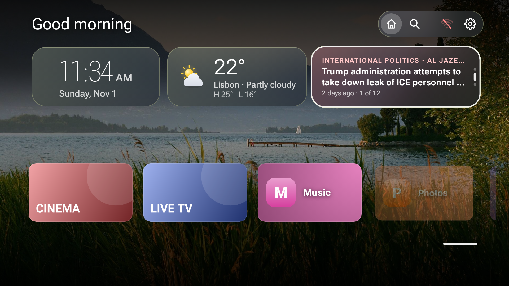</p>

Choose what goes in it under **Settings → Widgets → Widget stack**: OK adds or removes a widget, and holding OK on one, then **Left** / **Right**, moves it, the same way as moving a favourite. While the Widgets pages are open, the home screen steps aside to the left of the panel, undimmed, as a live preview: the stack there shows the widget you're on, and each change shows at once.

<p align="center">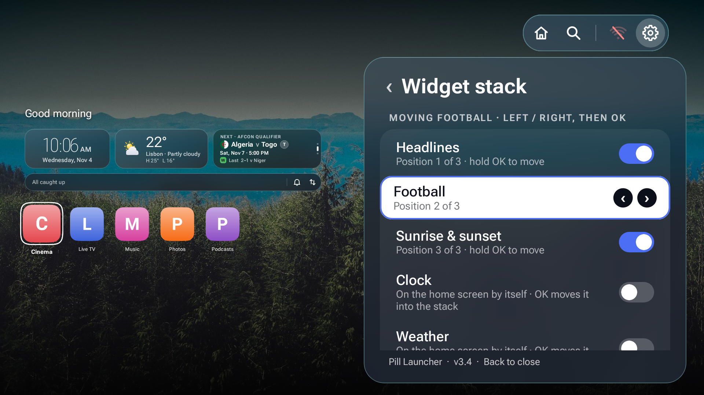</p>

OK on the clock card opens the clock page: the time with seconds, the date in the Gregorian and Islamic calendars, the week and day of the year, this month, and world clocks.

<p align="center">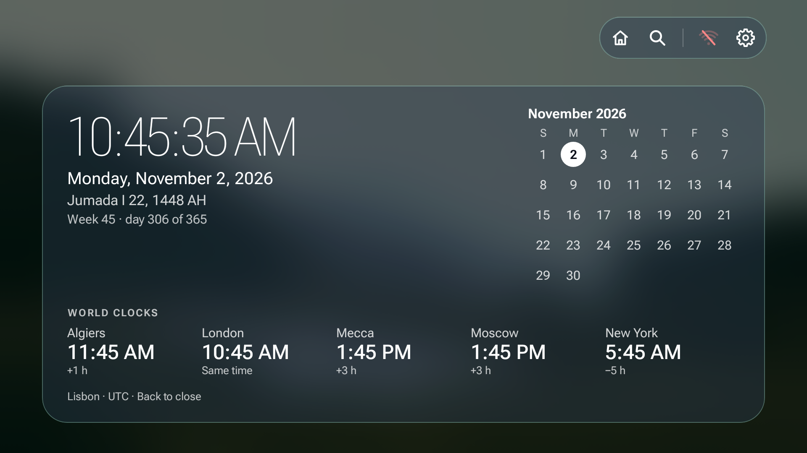</p>

The weather, football, headlines and prayer pages are described in their own sections below.

### Internet

**Wi-Fi** in the bar opens the Internet page: a speed test and a way into the TV's network settings. See [Internet speed test](#internet-speed-test).

<p align="center">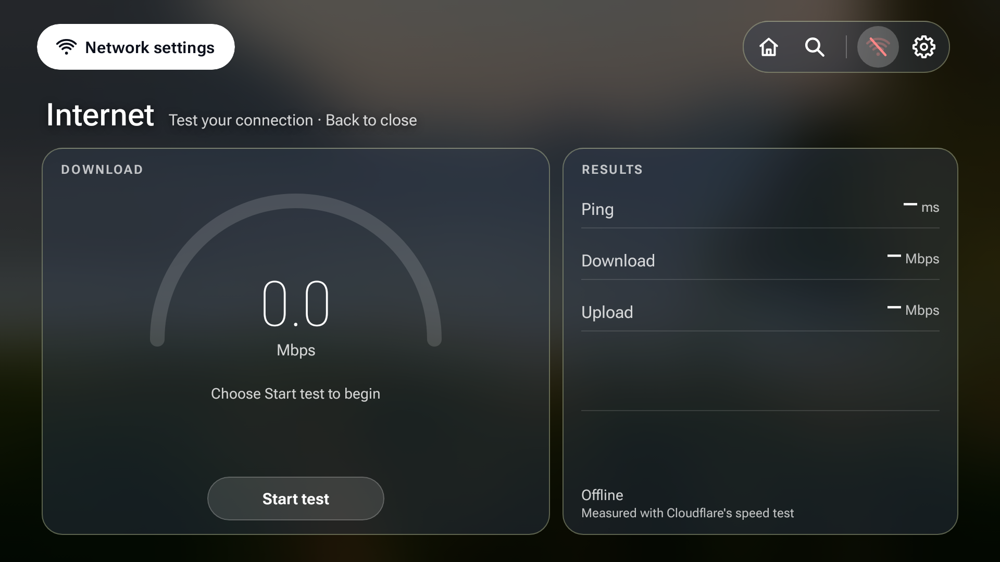</p>

### Notifications

The bar under the widgets is as wide as they are. On the left is the newest notification, with how long ago it came and **+3** when there are more; **OK** on it does what it says (installs the update, opens the football page or the file), and holding **OK** dismisses it. With nothing new it says **All caught up**. On the right are the **bell**, with a red dot for anything new, and **Files**. **Down** from any widget lands at the start of the bar, and **Down** again goes to the first app in Favorites, at the left.

<p align="center">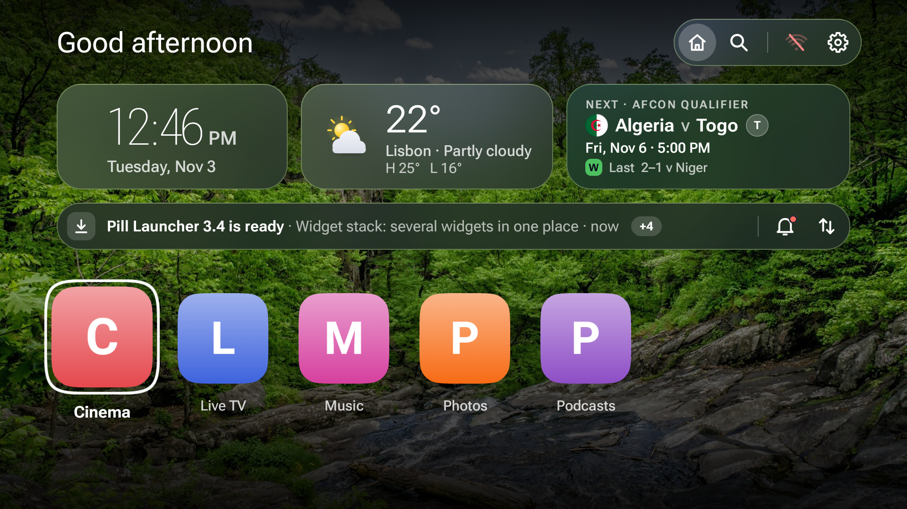</p>

**OK** on the bell opens the bar downwards into every notification, over Favorites, with the widgets still in view. They're grouped by where they came from (Pill Launcher, Files, football, the connection, each app), each group on its own card under its name. An update has **Update** and **Later** beside it, and its progress while it downloads. **Clear all** is at the top right; **Back** folds the list up again. A new notification slides into the bar and the bell gives a small swing; nothing ever pops up over what you're doing, and the bar fades away on the idle screen.

Pill Launcher's own notifications:

- **Updates**: a new version is ready, "Updated to 3.3" with what was new in it, or why an update didn't install.
- **Football**: the kick-off reminder ten minutes before a followed team plays, then goals and wins.
- **Connection**: when the internet has been gone a minute, then "Back online" with how long it dropped.
- **Prayer times**: each prayer as its time comes, with its iqama, for a quarter of an hour, while the prayer times widget is on. **OK** on it opens the prayer page.
- **Files**: each file that arrives from a phone.

**Other apps' notifications** show too once the TV allows it: **Settings → Notifications → Other apps' notifications** opens the TV's **Notification access** screen. Many TVs hide that screen; then it's allowed once from a computer with `adb shell cmd notification allow_listener app.pill.launcher/app.pill.launcher.NotificationWatcher`. Low-memory TVs don't allow it at all. Ongoing ones (music playing, downloads) stay out, and each app can be muted on the same page. **Hide private messages** shows a notification an app marks private (a message's text, say) as just "New notification" under the app's name.

<table>
  <tr>
    <td width="50%">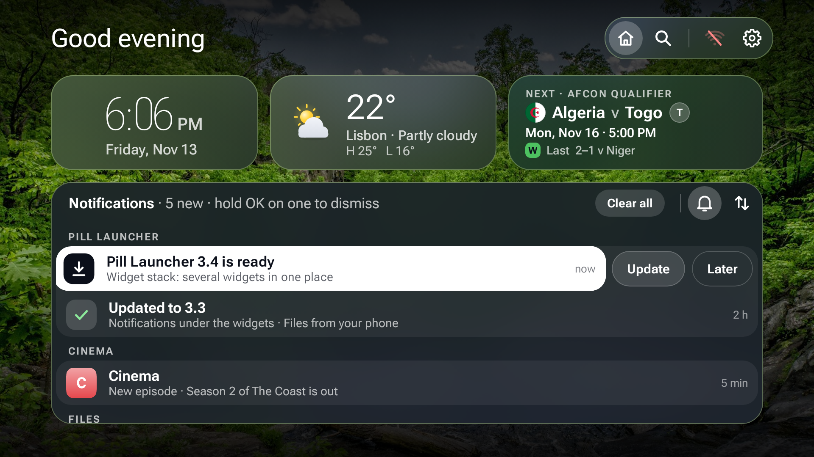<br><sub><b>The list</b>: OK on the bell opens every notification, grouped by source.</sub></td>
    <td width="50%">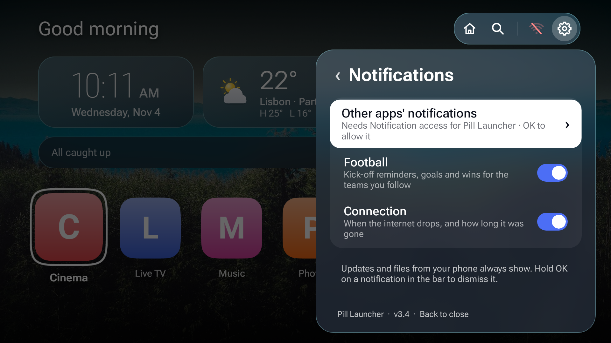<br><sub><b>Settings → Notifications</b>: other apps, football, the connection and prayer times.</sub></td>
  </tr>
</table>

### Files

**Files** in the notification bar opens a page of its own. On the left is **Receive**: a code to scan with your phone's camera (or the TV's address and a six-digit code to type), each file arriving with its progress, and the space left on the TV. On the right is everything on the TV, as cards like the apps in All apps, with chips for **Photos**, **Videos**, **Apps** and **Documents**.

**OK** on a file opens it: photos in the launcher's own viewer (**Left** / **Right** for the next one), videos and documents in the TV's apps, and an app's APK with Android's install screen. Holding **OK** offers **Install** or **Open**, **Send to phone** (a code that saves it on your phone) and **Delete**.

Your phone opens a plain page in its browser, with nothing to install: **Send to TV** picks photos, videos or files and shows each one's progress, **Send a link** sends a web address for [Add an app or website](#apps-and-websites-from-a-link), and the TV's files are listed with **Save**. The phone must be on the same home network as the TV (the TV on a cable and the phone on Wi-Fi is fine; a guest Wi-Fi usually keeps devices apart). Under the code, the Files page shows the last phone that reached the TV, from which address, and how that went. If a scan fails and the TV still says no phone has reached it, the phone isn't reaching the TV at all, and the page says what to check. On a phone with Android 17, Chrome is kept off the home network until it is allowed (it then says the site can't be reached, with ERR_TOO_MANY_RETRIES): on the phone, open **Settings → Apps → Chrome → Permissions** and allow **Nearby devices**. Otherwise, check that the phone is on the same Wi-Fi, not on mobile data, and that no VPN is on.

<table>
  <tr>
    <td width="66%">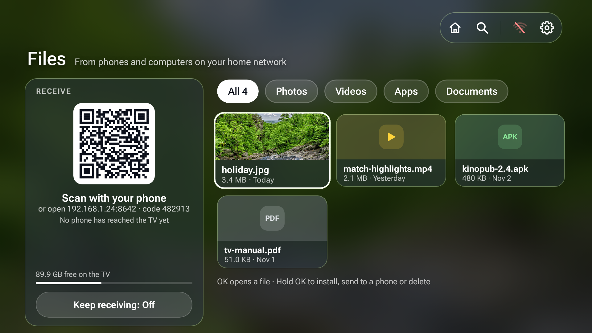<br><sub><b>Files on the TV</b>: receiving on the left, everything on the TV on the right.</sub></td>
    <td width="34%">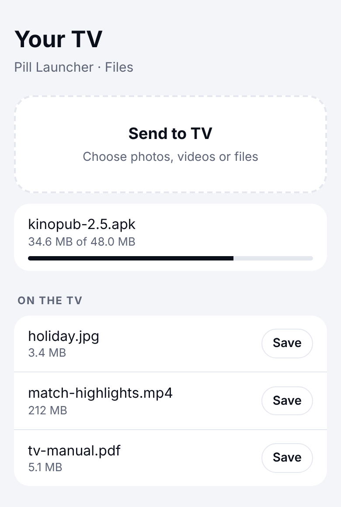<br><sub><b>On the phone</b>: send, or save what's on the TV.</sub></td>
  </tr>
</table>

**Pairing a phone.** Scanning the QR code pairs the phone at once: the code carries a long random key, and scanning it proves you're in the room. A phone that can't scan types the six-digit code instead, and the TV asks **Allow** or **Block** over whatever is showing. A paired phone stays trusted for 90 days, so the page works from a bookmark without scanning again. **Settings → Files** lists the trusted phones (OK removes one), and **Sign out every phone** makes a new code.

<table>
  <tr>
    <td width="50%">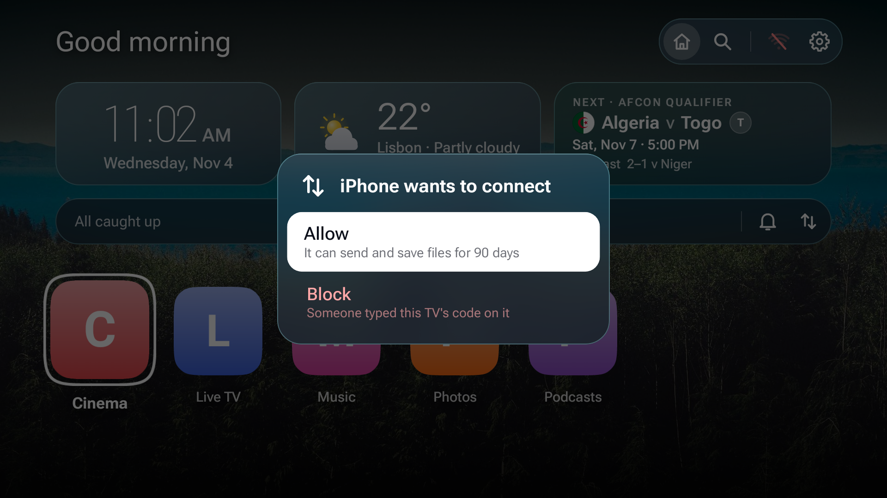<br><sub><b>A typed code</b>: the TV asks before the phone gets in.</sub></td>
    <td width="50%">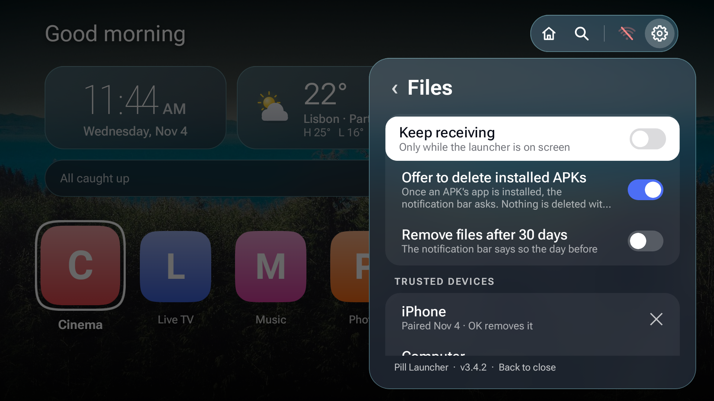<br><sub><b>Settings → Files</b>: keep receiving, tidying, and under Advanced the trusted phones.</sub></td>
  </tr>
</table>

**When it runs.** Sharing runs while the launcher is on screen, so a paired phone can send without the Files page open, and stops when another app comes to the front (or 15 minutes later with **Keep receiving** on). It listens only on the TV's home-network address and handles a few phones at a time. Every request must name the TV's own address, and anything that changes something must come from the TV's page, so another website open on the phone can't use it. Files go into Pill Launcher's own folder on the TV (uninstalling the launcher removes them).

**Tidying.** Files never deletes an APK on its own. Once the app inside an APK is installed, the notification bar asks: **OK** on the notice shows **Keep it** (where focus starts) or **Delete**, and holding **OK** keeps it. Each APK is asked about once (**Offer to delete installed APKs** in Settings → Files, on by default). **Remove files after 30 days** is off unless you turn it on, and then a notice comes the day before.

<p align="center">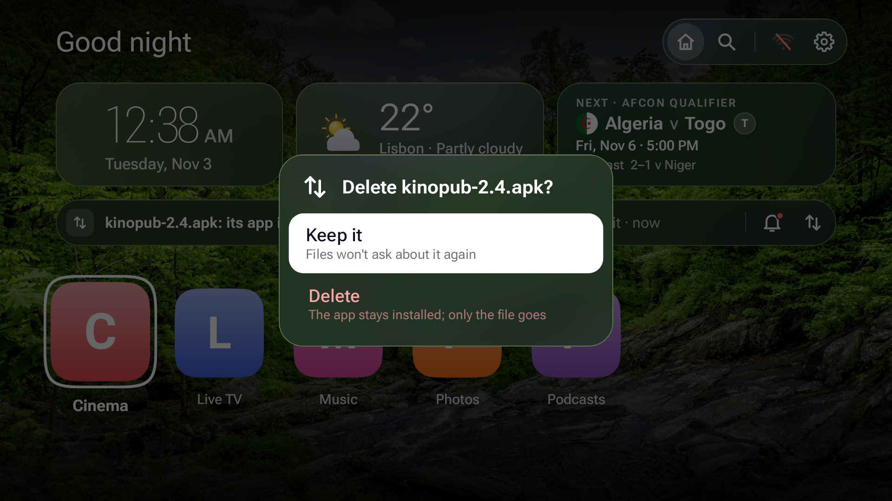</p>

### Settings

**Settings** in the bar opens a floating card with six categories, all on screen at once: **Home screen** (the photos, the favourites row and the idle screen), **Widgets**, **Notifications**, **Files**, **Home & startup**, and **TV & system**. **TV & system** holds the launcher's **Updates**, frees memory, opens the TV's network, display, sound, storage and update screens, and backs up and restores the launcher's settings (see [Backing up your settings](#backing-up-your-settings)). Options few people need, such as the prayer times' API address and the list of trusted phones, wait under an **Advanced** row on their page; OK unfolds them.

<table>
  <tr>
    <td width="50%">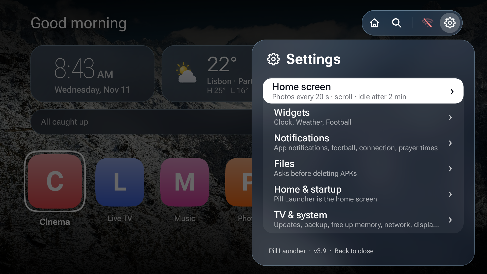<br><sub><b>Settings</b>: each row shows its current choice.</sub></td>
    <td width="50%">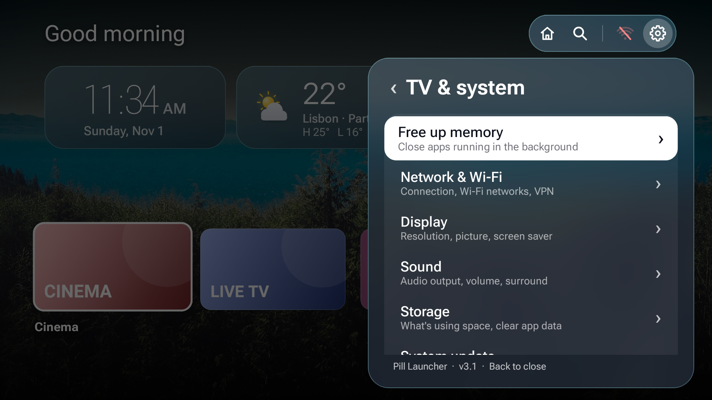<br><sub><b>TV & system</b>: the launcher's updates, then the TV's own screens.</sub></td>
  </tr>
</table>

### Languages

Pill Launcher speaks **English**, **French** and **Arabic**. It follows the TV's language when it is one of the three, and English otherwise; **Settings → TV & system → Language** chooses one whatever the TV is set to. The screen starts again in the new language at once.

Everything the launcher itself says changes: the greeting, the widgets, the pages, Settings and its own notifications, with dates and month names in the language's own form (Arabic as written in Algeria, with Western digits). In Arabic the whole screen runs right to left: the bar moves to the top left, the favourites start from the right, and **Left** / **Right** move along a row the way it now reads. A football score keeps its order ("2–1"). Arabic letters stand taller than Latin ones, so a card that runs out of room leaves out its last line (on the football card, the last result) rather than cutting it in half.

What comes from elsewhere stays as it comes: app names, headlines, team and competition names, the mosque's name, and other apps' notifications. The page a phone opens to send files is in English.

<table>
  <tr>
    <td width="50%">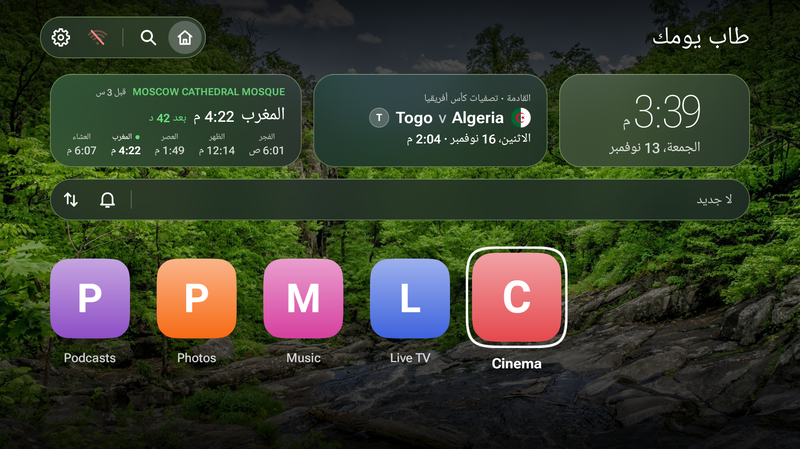<br><sub><b>Arabic</b>: right to left.</sub></td>
    <td width="50%">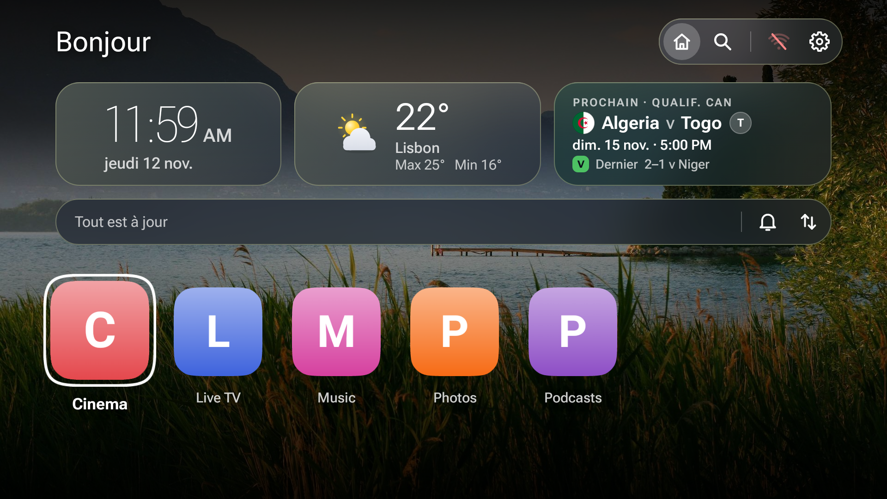<br><sub><b>French</b>.</sub></td>
  </tr>
</table>

### Updates

When a newer Pill Launcher is on GitHub, the notification bar says so, with the first line of what's new. **OK** on it (or **Update** in the list) downloads it with a progress bar, then Android asks you to confirm the install; settings and favourites stay, since every release is signed with the same key. **Later**, or holding **OK** on it, puts it off until the next version. The first time, Android asks to allow Pill Launcher to install apps. After an update, "Updated to …" says what was new.

**Settings → TV & system → Updates** checks by hand, installs from there with the same progress, lists what's new, and turns off the check every few hours.

<p align="center">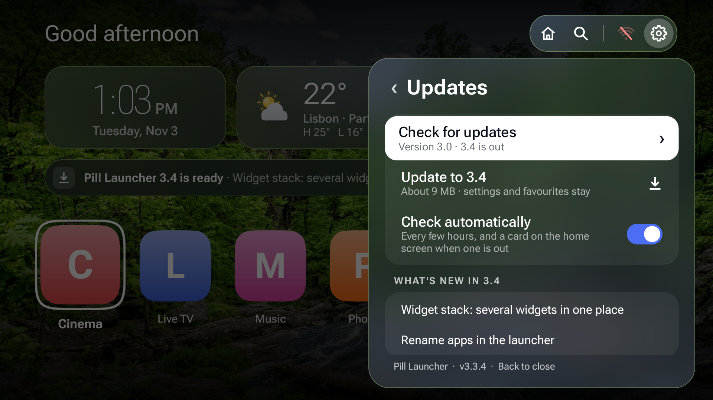<br><sub><b>Settings → Updates</b>: check, install and what's new.</sub></p>

### Safe mode

If the launcher ever crashes twice within a minute (after a bad update, say), it starts in safe mode instead of crashing again: the photo and Favorites only, without widgets, the notification bar or Files, and a line saying what went wrong. **Try normally** starts it as usual, and a minute of normal running forgets the crashes. You're never locked out of the TV.

<p align="center">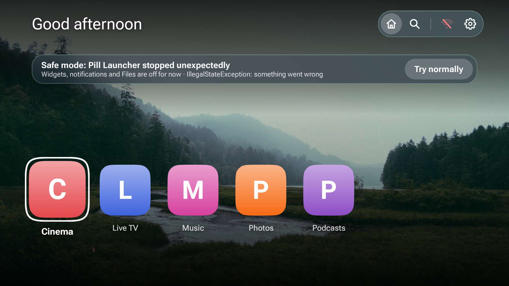</p>

### Idle screen

After a while without a key press (two minutes by default, under **Settings → Home screen → Idle screen**), everything but the widgets fades away (the notification bar too) and the photo slowly zooms. Nothing else is on the photo: no captions or credits. Any key brings the home screen back.

<p align="center">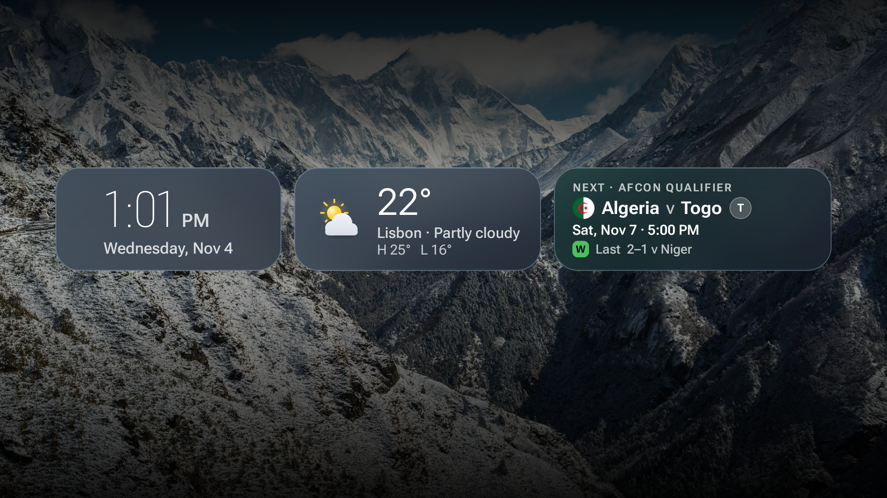</p>

## Install

1. On the TV, install **Downloader** (by AFTVnews) from the Play Store.
2. Open it and enter `https://github.com/S1rHades/One-TVOS/releases/download/latest/launcher.apk`.
3. Allow Downloader to install unknown apps when Android asks, then choose **Install**.

To make it your home screen, open **Settings** (the gear) → **Home & startup** → **Default home screen**. Android asks you to confirm; after that, Home and closing or killing any app bring you back to Pill Launcher.

Many TVs, most Google TV devices among them, don't let any app replace the home screen. On those, use **Settings → Home & startup → Home button helper**: it opens Accessibility settings, where you turn on **Pill Launcher Home button**. Whenever the TV's own home screen opens (Home pressed, an app closed or killed), the helper brings Pill Launcher straight back. It only checks which app came to the front, never what is on screen. On Android 13 and later, a sideloaded app's accessibility switch may be greyed out at first: open **Settings → Apps → Pill Launcher**, choose **⋮ → Allow restricted settings**, then turn it on.

A new install starts with **Getting started** above the favourites: a ring that fills as the steps are done (installed, the home screen, your favourite apps, the widgets, your town for the weather), the next step with its button, and **Not now**. The town step is already done when a mosque is chosen (the weather goes by its place) or no weather widget is on. It begins one step in, and when the last is done it says **You're set** and goes. After that, until the home screen is set up, a reminder with a **Set up** button stays, which tries the first way and then the second. **Not now** hides it.

<p align="center">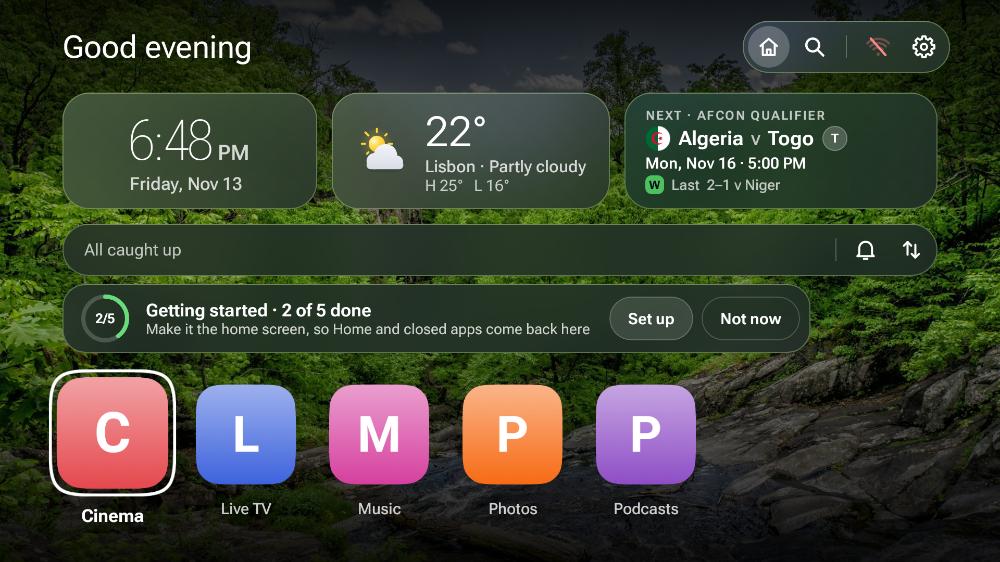</p>

<p align="center">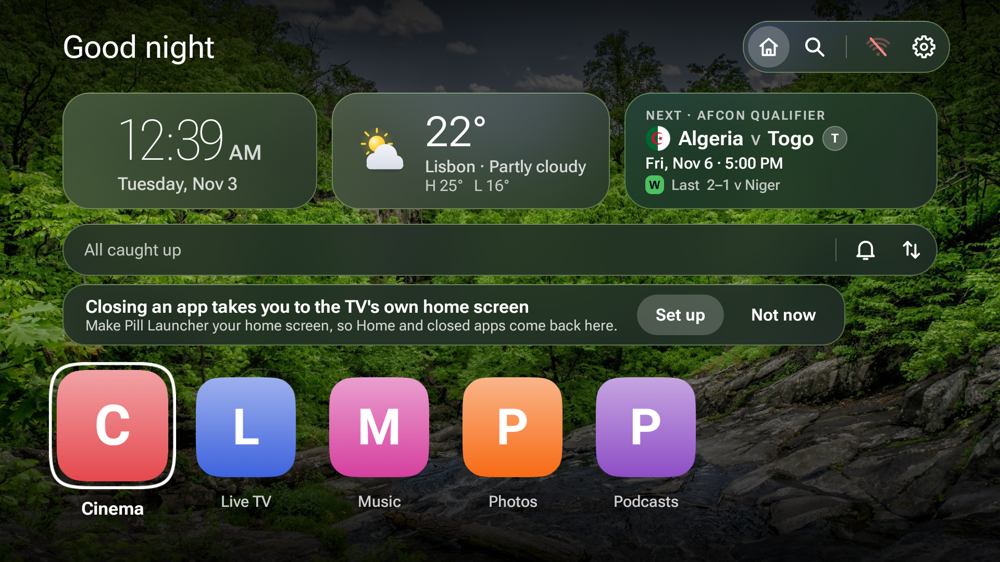</p>

If a TV allows neither, a computer with [ADB](https://developer.android.com/tools/adb) connected to the TV can make Pill Launcher the home screen:

```
adb shell cmd package set-home-activity app.pill.launcher/.MainActivity
```

On TVs that ignore that command, turning off the stock launcher works too (turn it back on with `pm enable`). On Google TV, run `adb shell pm disable-user --user 0 com.google.android.apps.tv.launcherx`; on Android TV, run `adb shell pm disable-user --user 0 com.google.android.tvlauncher`.

The `latest` release is rebuilt automatically every time `main` changes, so installing it again always gets you the newest version.

Every version also keeps its own release, named after it (**Pill Launcher 4.1.1**, tag `v4.1.1`, file `pill-launcher-4.1.1.apk`), so an older version stays downloadable: `https://github.com/S1rHades/One-TVOS/releases/download/v4.1.1/pill-launcher-4.1.1.apk`. The newest is titled **Pill Launcher 4.1.1 (latest)** and holds the same file under its version's name, plus `launcher.apk`, the copy behind the link above that never changes. Releases from 2.5 on are kept; older ones weren't saved.

### Backing up your settings

**Settings → TV & system → Back up settings** saves everything you've set up as one small file in Files, named `pill-launcher-backup-` and the date: your favourites and their order, the names you gave apps, the widgets, teams, your mosque, the weather town and every switch. Open the **Files** page and send it to your phone to keep it; a reinstall removes the TV's copy with everything else.

To put a backup back, on this TV or another: send the file from your phone to the TV on the Files page, then choose **Settings → TV & system → Restore settings**. It takes the newest backup in Files, says which one and when it was made, and asks for **OK** a second time before it replaces the settings. Paired phones, notifications and fetched data (the weather, fixtures, prayer times) aren't in a backup: phones pair again, and the data is fetched again.

### Uninstalling

From the launcher: **Settings → TV & system → Uninstall Pill Launcher**, then OK twice and confirm.

If the launcher won't open, use the TV's own **Settings → Apps → Pill Launcher → Uninstall**. Either way, the TV's own home screen takes over afterwards.

## Using it

| To | Press |
| --- | --- |
| Open an app | **OK** |
| Reach the bar at the top right, and leave it | **Up** from the widgets; **Down** goes back to them |
| Reach the notification bar | **Down** from the widgets (or **Up** from Favorites) |
| See every notification | **OK** on the bell in the notification bar; **Back** folds it up |
| Act on a notification, or dismiss it | **OK** on it, or hold **OK** |
| Clear every notification | Open the list, then **Clear all** |
| Show other apps' notifications, mute one, or turn off football or connection ones | **Settings → Notifications** |
| Send a file from your phone to the TV | **Files** in the notification bar, scan the code with the phone, then **Send to TV** |
| Open, install, send to a phone or delete a file on the TV | **Files**, then **OK** on it, or hold **OK** |
| Keep receiving files after leaving the launcher | **Keep receiving** on the Files page or in **Settings → Files** (15 minutes) |
| Let in a phone that typed the code | **Allow** on the card the TV shows |
| Remove a trusted phone, or sign every phone out | **Settings → Files → Advanced** |
| Delete an installed app's APK | **OK** on its notice in the bar, then **Delete** (hold **OK** to keep it) |
| Files tidying: asking about installed APKs, removing files after 30 days | **Settings → Files** |
| Hide the text of private messages | **Settings → Notifications → Hide private messages** |
| Add a website or an app from a link | **Settings → Home screen → Add an app or website**, or **Send a link** on the phone's Files page |
| In a website: move the pointer, click, scroll | Arrows, **OK**; at the screen's edge the arrows scroll |
| In a website: back a page, or leave it | **Back** (from its first page, Back leaves) |
| In a website: reload, text size, page size, whole screen, links mode, TV version | Hold **OK**, or press **Menu** (☰) |
| Remove a web shortcut | Hold **OK** on its tile → **Remove shortcut**, or **OK** twice on it in Add an app or website |
| See all apps | **Down** from Favorites |
| Show only video, music or game apps | **Down** to the chips above All apps, **Left** / **Right**, then **OK** |
| Find an app | The remote's search key, or **Search** in the bar, then letters from the strip (**Left** / **Right**, OK), or **Up** to the field for the keyboard |
| Test the internet speed, or open Wi-Fi settings | **Wi-Fi** in the bar, then **Start test** or **Network settings** |
| See if a VPN is on | The Internet page says so |
| Change how favourites are laid out | **Settings → Home screen → Favorites row → Layout**: Scroll or Wrap |
| Order favourites by how often you open them | **Settings → Home screen → Favorites row → Order**: By use |
| Wake the idle screen | Any key |
| App menu: pin / unpin, move, app info, uninstall | Hold **OK** for half a second, or press **Menu** (☰) |
| A widget's menu: its settings, move it, remove it | Hold **OK** on the card, or press **Menu** (☰) |
| Reorder favourites | App menu → **Move**, then **Left** / **Right**, and **OK** when done (not while they're ordered by use) |
| Open settings | **Settings** (the gear) in the bar, then **OK** |
| Rename an app | App menu → **Rename…**, then **Save** |
| Flip through a widget stack | With it focused, **Up** / **Down** |
| Choose and order a widget stack's widgets | **Settings → Widgets → Widget stack**: OK adds or removes one; hold OK, then **Left** / **Right**, moves it |
| Install a newer version | **OK** on its notice in the notification bar, or **Settings → TV & system → Updates** |
| Choose the town the weather is for | **Settings → Widgets → Weather location**, type its name, then **OK** on it |
| Change how often the photo changes, or the weather unit | In settings, **Left** / **Right** on that row |
| Turn widgets on or off | **Settings → Widgets**, **OK** on a widget (up to four at once) |
| Reorder widgets | **Settings → Widgets**, **Left** / **Right** on a widget that's on |
| Open the clock page, the weather dashboard, the football page, the news page or the prayer page | Go up to that widget, then **OK** (**Back** closes it) |
| Pick a day on the weather dashboard | **Left** / **Right** |
| Pick a team on the football page, or a story on the news page | **Up** / **Down** |
| Switch teams on the football card | With it focused, **Left** / **Right** |
| Follow more teams, or change match day | **Settings → Widgets → Football teams** |
| Choose headline topics | **Settings → Widgets → Headlines** |
| Choose the mosque for prayer times, or refresh them now | **Settings → Widgets → Prayer times** |
| See another prayer's time on the prayer card | With it focused, **Left** / **Right** (it goes back to the next prayer after 10 seconds) |
| Open the prayer page, and refresh the times | Go up to the prayer card, then **OK**; **Refresh** at the top left |
| Free up memory, or open the TV's network, display, sound or update screens | **Settings → TV & system** |
| Change the launcher's language (English, French, Arabic) | **Settings → TV & system → Language** |
| Back up the launcher's settings to a file, or restore them from one | **Settings → TV & system → Back up settings** / **Restore settings** (OK twice) |
| Uninstall Pill Launcher (OK twice, then confirm) | **Settings → TV & system → Uninstall Pill Launcher** |
| Close a page or settings | **Back** (pages say so the first three times) |

Settings and favourites are saved on the TV and survive restarts and updates.

### Weather and forecast

The forecast comes from [Open-Meteo](https://open-meteo.com/), or from [MET Norway](https://api.met.no/) if Open-Meteo can't be reached, for an exact point, so a small town gets its own weather. Where that point is depends on **Settings → Widgets → Weather location**:

- **Automatic** (the default) goes by your mosque's place when one is chosen under Prayer times and MAWAQIT says where it is: the TV is near its mosque, so the forecast is for there, and the town's name is looked up once on OpenStreetMap. With no mosque, it finds the TV's approximate location from its internet address with [GeoJS](https://www.geojs.io/), which is often the provider's nearest city rather than your town.
- **A town you choose**: type its name, and OK on it in the list. Open-Meteo's place search covers small towns and villages, such as Beni Saf; it is tried as typed and without accents or hyphens, and when it finds nothing, OpenStreetMap's place search is asked too. Typing a latitude and longitude, such as `35.30, -1.38`, works too.

<p align="center">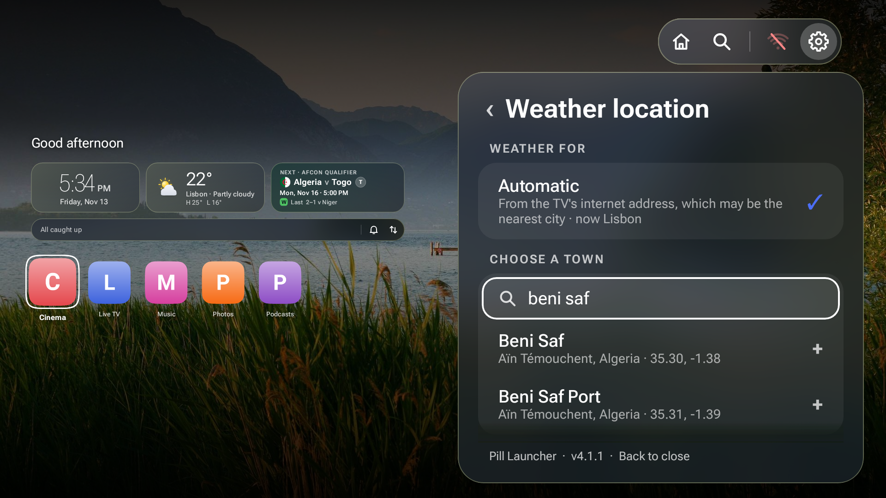</p>

None of these services needs an account or key. It refreshes every 30 minutes, and at once when the TV wakes after sleeping through a refresh, or when the internet comes back after a failed one (the same goes for football, headlines, prayer times and the online photos). Choose °C or °F in settings. Turn off both the Weather and the Sunrise & sunset widgets, and the launcher contacts none of these services. If the weather can't load, Settings shows why under the Weather widget's row. Sunrise and sunset are worked out on the TV from the same location.

OK on the weather card opens the weather dashboard:

- **Now**: "feels like" (with a line for the next day's temperatures), humidity, wind with its direction, and the UV index.
- **7 days**: each day's range as a bar. **Left** / **Right** picks a day, and its bar lights up in the photo's colour with the range above it.
- **Today**: the next sunrise or sunset, when rain is likely, the warmest or coolest hour to come, and tomorrow.

<p align="center">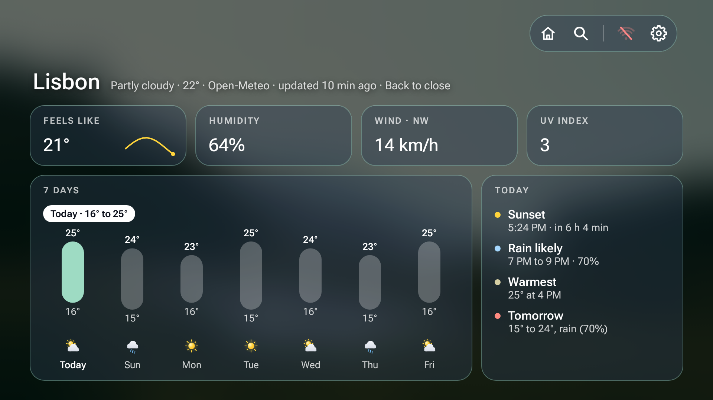</p>

MET Norway gives no "feels like", UV or chance of rain, so with it the page shows the expected rain in mm instead. The last reading is saved on the TV, so the card and the dashboard show at once after a restart and while offline.

### Football

The football widget follows Algeria's men's team (always first) and up to five more teams you add under **Settings → Widgets → Football teams**: search for a club or a country. The card takes turns between them every 20 seconds, each with its next fixture (competition, crests and kick-off in the TV's time zone) and latest result, marked W, D or L. During a match it shows **LIVE** and the score.

With more than one team, the card takes turns between them every 20 seconds, and a thin line along its bottom fills up until the next one. With the card focused it waits, and **Left** / **Right** flip between the teams by hand (past the first or last, they move on to the next widget). On a match day the card takes turns only between the teams that play, but **Left** / **Right** still reach every team you follow, and after one turn the card comes back to the match.

<p align="center">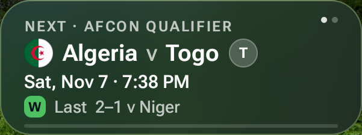</p>

OK on the card opens the football page: your teams down the left (**Up** / **Down** picks one), and the next match with a countdown and the latest result filling the rest. The free data has no league tables worth showing, so the page leaves them out.

<p align="center">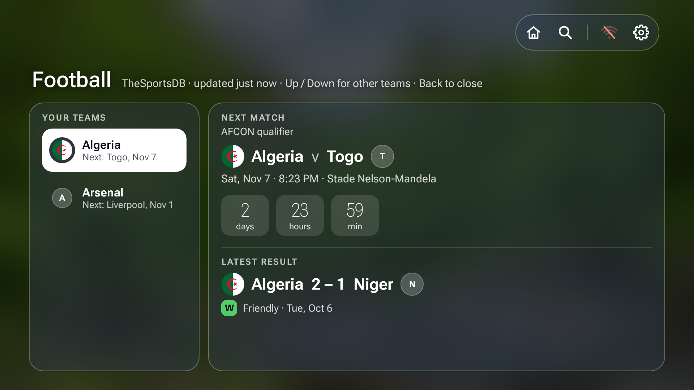</p>

**Goals and wins**: when a team you follow scores, its card flashes green, the score flips to the new one, and the last line says "Goal · Algeria 78'" (the minute is worked out from kick-off, since the free data has no clock). A win ends at full time in a short burst of confetti inside the card. A widget stack holding the football card brings it forward. The data refreshes every 3 minutes around a match, so the card lights up a little after the real goal. Every line stays on one line inside the card: long team names give way with an ellipsis before the score does. Nothing moves on the idle screen.

<p align="center">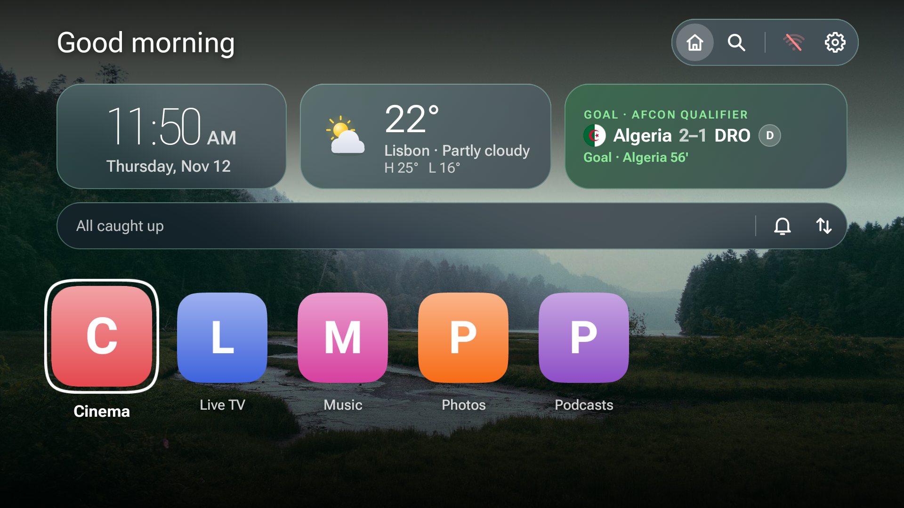</p>

**Match day**: on the day a followed team plays, the card stays on that team and counts down to kick-off, and from ten minutes before until just after, the notification bar says so (it never takes focus; hold **OK** on it to dismiss it). Goals and wins go into the notification bar too, so you can see them later. Choose all teams, Algeria only, or off under **Football teams → Match day**.

<table>
  <tr>
    <td width="50%">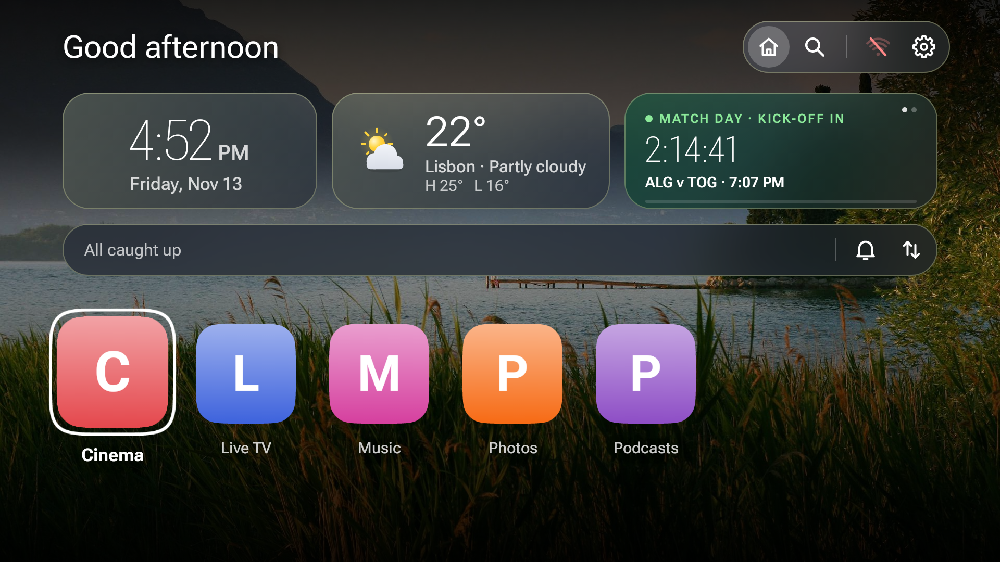<br><sub><b>Match day</b>: the football card counts down to kick-off.</sub></td>
    <td width="50%">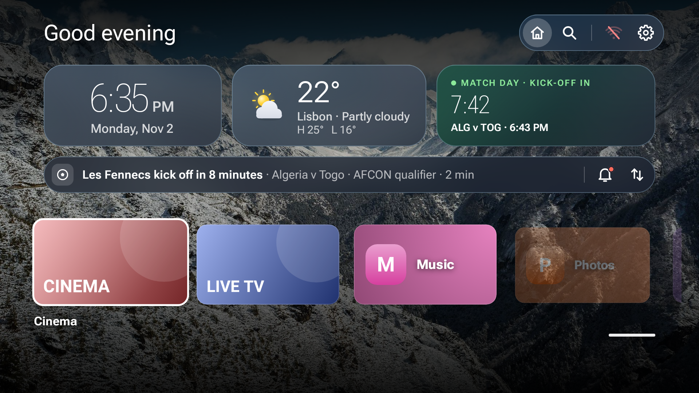<br><sub><b>Kick-off reminder</b>: ten minutes before, in the notification bar.</sub></td>
  </tr>
  <tr>
    <td width="50%">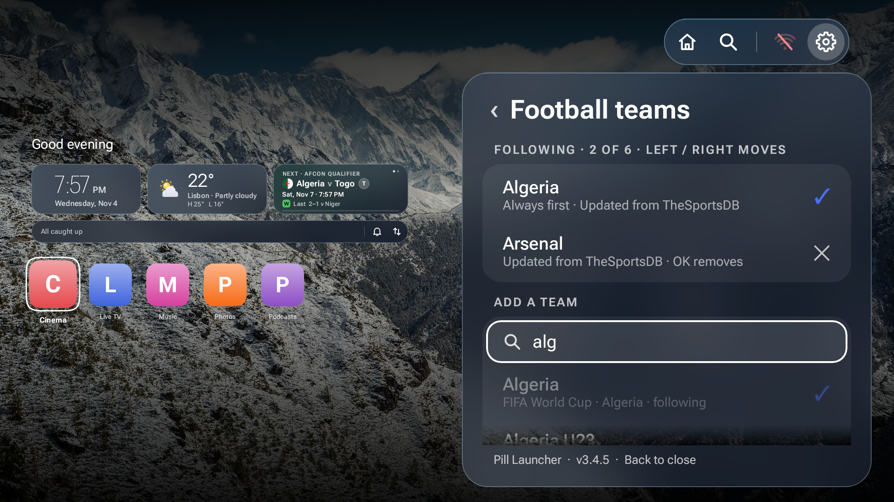<br><sub><b>Follow teams</b>: search for a club or country and add up to five beside Algeria.</sub></td>
    <td width="50%"></td>
  </tr>
</table>

The data comes from [TheSportsDB](https://www.thesportsdb.com/)'s free API, with no account needed. The free data has one next match and one latest result per team, and only the top five of a table. Many TVs can't reach TheSportsDB (its Cloudflare protection turns some away), so the **Fixtures mirror** workflow (`.github/workflows/fixtures.yml`, `.github/scripts/mirror.py`) keeps copies on the `fixtures-data` branch for Algeria (every 30 minutes) and for about 120 clubs and national teams listed in `.github/mirror/teams.txt` (each every few hours, and every 30 minutes around its matches). Search shows which teams work on any network; others need the TV to reach TheSportsDB directly. To add a team for every network, add its name to `teams.txt`. The widget refreshes every 30 minutes, and every 3 minutes around a match. Each team's last good copy is saved on the TV.

### Headlines

The headlines widget shows one story at a time from [Al Jazeera English](https://www.aljazeera.com/) and [RT English](https://www.rt.com/), newest first, a new one every 20 seconds.

OK opens the news page: every picked headline in a list on the left, and the story beside it, with its topic, source, age and summary. **Up** / **Down** moves through the list, and the story dissolves to the next.

<table>
  <tr>
    <td width="50%">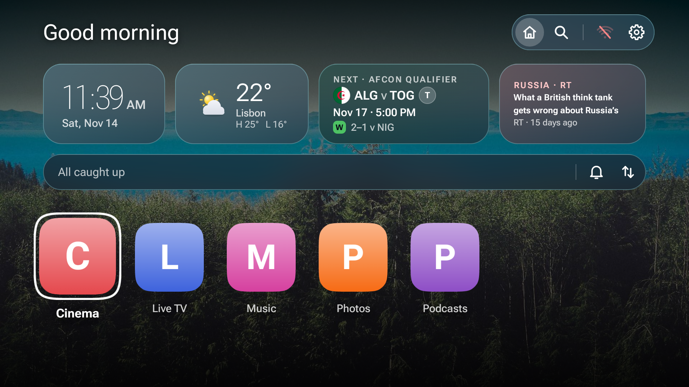<br><sub><b>Headlines card</b>: one story at a time, picked by topic.</sub></td>
    <td width="50%">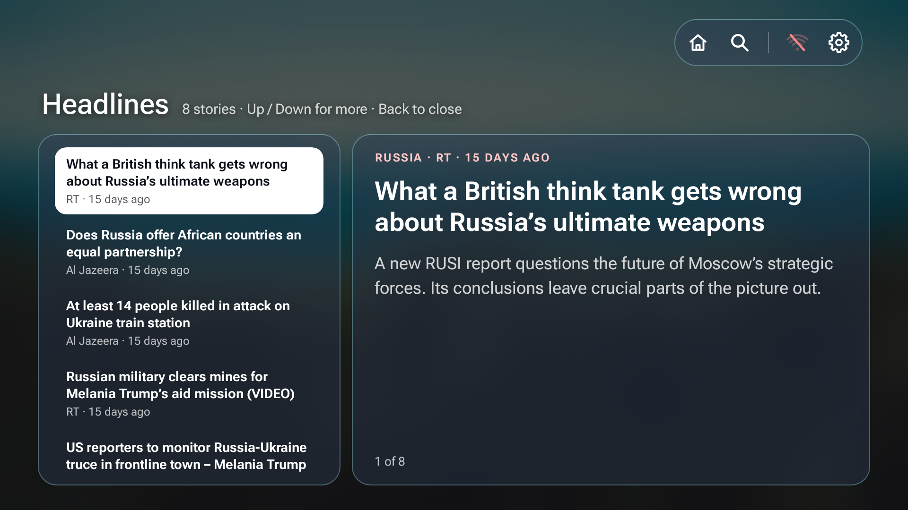<br><sub><b>News page</b>: the whole list, with the story beside it.</sub></td>
  </tr>
</table>

Neither site has feeds by topic, so the launcher picks stories itself, by section and by words in the headline and summary, for the topics on under **Settings → Widgets → Headlines**: Algeria, Russia and International politics by default, plus Africa & Middle East, Economy and Sport. If nothing matches, it shows the newest stories as top stories.

Al Jazeera is read from its RSS feed, or from a copy the Fixtures mirror keeps on `fixtures-data` (headline, link, date and short summary only). RT is only ever read directly by the TV: it is banned from distribution in the EU and blocked in some other countries, so it is never copied to GitHub. Where it is blocked, Settings says "Not available on this network" and the widget carries on with Al Jazeera.

### Prayer times

The prayer times widget shows today's five prayers from your mosque on [MAWAQIT](https://mawaqit.net), read from the mosque's page on mawaqit.net, with the community MAWAQIT API (`https://mawaqit-api.vercel.app/api/v1/<mosque>/`) as a fallback; no account or key. The card names the mosque, shows the next prayer with its time and how long until it, ticking every minute, and the five prayers along the bottom with the next one marked. In a compact layout it shows the prayer after the next instead of the row, or on a Friday, until it begins, the Friday prayer where the mosque gives its time. After Isha it counts down to tomorrow's Fajr, at tomorrow's own time. With the card focused, **Left** / **Right** step through the day's prayers: the picked one's time takes the big line, with how long ago it was or how long until it, and the card goes back to the next prayer ten seconds after the last press, or when you move off it.

<p align="center">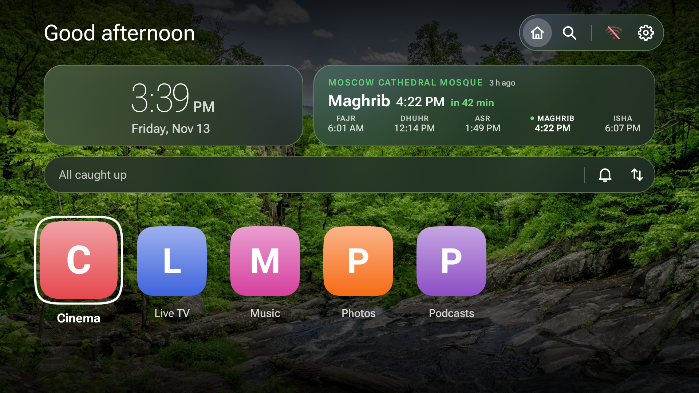</p>

OK on the card opens the prayer page: the next prayer large with the time left and its iqama, the day as a line from Fajr to Isha with a mark for now, and every prayer with its adhan and iqama times where the mosque gives them, with the **Friday prayer** under them when the mosque has one. The title gives the Islamic date as the mosque counts it (the Umm al-Qura calendar, moved by the day or two MAWAQIT says the mosque is off it) and says when the times last came. **Refresh** at the top left asks MAWAQIT again: its arrows turn while it asks, and it says **Updated ✓** for a moment when the new times are in. Changing the TV's time zone, date or clock fetches them again by itself.

<p align="center"></p>

At each prayer's time a notice joins the notification bar for a quarter of an hour, with the prayer, its time and its iqama. **Settings → Notifications → Prayer times** turns it off.

<p align="center"></p>

The times are saved on the TV, so the card has them at once after a restart or while offline (the label turns grey and the page says "saved"), and they refresh on their own just after midnight for the new day. A failed fetch keeps the saved times and tries again, after 10 seconds, then 30, a minute, two, five. MAWAQIT's page carries the mosque's calendar for the whole year, and it is saved with the times: on a day the TV can't reach MAWAQIT (offline at midnight, or for a week), the card shows that day's times from the saved calendar, and the page says so. Only a mosque whose answer has no calendar keeps yesterday's times up, marked, until the new day's arrive.

Choose the mosque under **Settings → Widgets → Prayer times** by its MAWAQIT ID, the number at the bottom left of the mosque's MAWAQIT screen, or by the end of its mawaqit.net address (for `mawaqit.net/en/obada-benisaf` that is `obada-benisaf`; pasting the whole address works too), then Done. The page says which mosque that is by name (**✓ Found: …**), so you can tell it's the right one, and mosques that worked before stay under **Recent**, one press away. The times are read from the mosque's own MAWAQIT page, where its screen gets them, with the community API as a fallback. There is no mosque search: MAWAQIT doesn't allow other apps to use its search. An ID or address MAWAQIT doesn't know says so, a failure names what each source answered, and every failed check shows the time it was made, so **Refresh** visibly tries again.

<p align="center"></p>

### Internet speed test

**Wi-Fi** in the bar opens the Internet page (pictured [above](#internet)). **Start test** measures the connection against [Cloudflare's speed test](https://speed.cloudflare.com/) service:

1. **Ping**: the quickest of a few tiny requests, in milliseconds.
2. **Download**: about seven seconds of downloading. The dial follows the speed live, and when the test ends its verdict springs in under the number.
3. **Upload**: about five seconds of uploading.

When it's done, a chip says in plain words what the speed is good for: 4K streaming (25 Mbps or more), HD streaming (10 or more), standard video (4 or more), or slow. The results card shows all three numbers, the network (with its signal on Wi-Fi, and whether a VPN is on) and when the last test ran. The last result is saved on the TV. Nothing is measured until you press **Start test**, and Back stops a test at once. **Network settings**, at the top left of the page and focused when it opens (**Down** goes to Start test), opens the TV's own Wi-Fi and network screen.

### Online photos

By default the slideshow shows a new set of 24 landscape photos each day from [Wikimedia Commons' Featured Pictures](https://commons.wikimedia.org/wiki/Commons:Featured_pictures) (mountains, lakes, forests, waterfalls and coasts). The **Photo feed** workflow (`.github/workflows/photo-feed.yml`, `.github/scripts/photo_feed.py`) picks them each morning, resizes them to 1920×1080 and publishes them with their credits on the `photos-data` branch. The TV reads them from `raw.githubusercontent.com`. The photos are freely licensed (mostly CC BY-SA): **Settings → Background** shows the photo on screen's full credit and licence. Offline, the TV uses the last set it saw and the built-in photos.

### Your own photos

The twelve built-in nature photos (used offline, or with **Online nature photos** off) are part of the app (`app/src/main/assets/photos`), so they show even without internet. To change them, edit the Lorem Picsum ids in `BackgroundSources` (`app/src/main/java/app/pill/launcher/ui/BackgroundSlideshow.kt`) and in `.github/workflows/photos.yml`, then run the **Bundle photos** workflow. `BackgroundSources` also accepts direct `https://` image links.

<sub>Screenshots are rendered at 1920×1080 from the app's own interface code by <code>.github/workflows/screenshots.yml</code>. The app names and icons in them are stand-ins; on your TV you'll see your installed apps. Photos: <a href="https://picsum.photos">Lorem Picsum</a> (Unsplash licence).</sub>

## Development

You need JDK 17 and the Android SDK (API 34). Android Studio works, or from the command line:

```
gradle assembleDebug                                   # app/build/outputs/apk/debug/app-debug.apk
gradle :app:testDebugUnitTest --tests '*Screenshots*'  # re-render docs/screenshots
```

**Text and translations.** The code is written in English: anything shown on screen goes through `tr("…")` (with `%1$s`, `%2$s` for values), and `Translations.kt` gives the French and the Arabic for each English text. A test (`everyTextIsTranslated`) reads the source and fails the build when a text has no translation or a translation has the wrong places for its values, so a new text can't ship in English only. Titles that enums carry (widget names, settings pages) translate when read. Rows that run with the reading direction use `rowStep()` for Left / Right, so they work right to left.

**Builds are automated.** `.github/workflows/build.yml` runs every test and then builds the APK for every pull request and push, so a failing test stops a release; builds of `main` publish a release for the version in `app/build.gradle.kts` (for example `v4.1.1`) and replace the `latest` release. `.github/workflows/screenshots.yml` re-renders the README screenshots at 1920×1080 and commits them; it runs on pushes that change the app, or from the Actions tab. `.github/scripts/check_readme.py` fails the build when this README falls behind the app: a picture that doesn't exist, a rendered screenshot that isn't shown, a source file missing from Architecture, or a version it doesn't name.

<details>
<summary><b>Architecture</b></summary>

```
app/src/main/java/app/pill/launcher/
  MainActivity.kt        launcher activity: loads apps, opens them, keeps pins and settings
  AppModel.kt            lists launchable apps with their icons and kinds (video, music, games)
  AppCache.kt            the app list as last seen, saved so a cold start shows the apps at once
  Refresh.kt             ends the data loops' waits early when the TV wakes or the internet returns
  LauncherSettings.kt    settings and pinned apps in SharedPreferences
  Lang.kt                the languages, the one on screen, and tr(): English text in the code, shown in that language
  Translations.kt        French and Arabic for every text, by its English
  Weather.kt             location and forecast lookup, condition names and units
  Widgets.kt             the widget kinds, the four-widget limit, toggling and reordering
  Football.kt            followed teams' fixtures and tables from TheSportsDB or the mirror
  MatchDay.kt            match-day countdown and the kick-off reminder
  News.kt                headlines from Al Jazeera and RT, picked by topic
  Prayers.kt             prayer times from a mosque on MAWAQIT: the answer, the mosque's calendar, the next prayer, the saved copy
  Backup.kt              the settings as one file, and putting one back
  SpeedTest.kt           ping, download and upload against Cloudflare's speed test
  Updates.kt             newer releases from GitHub: check, download, install, and the installer's answer (for links' apps too)
  Links.kt               Add an app or website: what a link is, a site's name and icon, web shortcuts and their tiles, installing from a link
  WebAppActivity.kt      a web shortcut full screen: the WebView, its keys, full-screen video
  Notifications.kt       the notification bar's notices: kept ones, updates, football, the connection, prayer times, and other apps' (NotificationWatcher)
  FileShare.kt           Files: the small web server phones send to, pairing and trusted phones, the files on the TV, tidying
  CrashGuard.kt          notes crashes; two within a minute start the launcher in safe mode
  Moments.kt             goals and wins noticed between football fetches, and the match minute
  PhotoFeed.kt           the daily Wikimedia photo set and its credits
  Daylight.kt            sunrise and sunset from latitude and longitude
  HomeSetup.kt, HomeRedirectService.kt   becoming the home screen, and the Home button helper
  BootReceiver.kt        opens the launcher when the TV starts, if Autostart is on
  ui/
    LauncherScreen.kt    the home screen: greeting, widgets, favourites, All apps below, page scrolling
    LauncherParts.kt     the home screen's smaller pieces: page scrolling, the idle presentation, titles, the toast
    NavBar.kt            the bar at the top right (Home, Search, Wi-Fi, Settings) and the greeting
    RenameDialog.kt      Rename… from the app menu
    NotificationBar.kt   the notification bar under the widgets, its list, the bell and Files buttons
    FilesPage.kt         the Files page: receiving, the TV's files as cards, the photo viewer, QR codes
    UpdateCard.kt        the progress bar and download icon shared by updates and Files
    Motion.kt            glass motion: durations, easing, dissolve, the reading-order wave, glide
    Overlay.kt           full-screen pages: blurred backdrop, open and close motion
    PageParts.kt         shared page title, cards and sparkline
    AllApps.kt           kind chips and colour app cards
    ClockPage.kt, ForecastPage.kt, FootballHub.kt, HeadlinePage.kt, InternetPage.kt, PrayerPage.kt   the pages
    WidgetCards.kt       the header's glass widget cards and their row: clock, weather, headlines, prayers, text that fits
    WidgetStack.kt       the widget stack: several widgets in one card's place
    FootballCard.kt      the football card: teams in turn, match day, goals and wins
    SystemCards.kt       the sunrise & sunset and system info cards
    WeatherWidget.kt     the weather card's content, with drawn condition icons
    PrayerWidget.kt      the prayer card's content: the next prayer, the countdown, the five in a row
    FavoritesRow.kt, AppTile.kt   the favourites row and its icon tiles
    SearchPanel.kt, SettingsPanel.kt, AppMenu.kt   panels over the home screen
    SettingsParts.kt     what settings pages are built from: groups, rows, switches
    SettingsWidgetPages.kt   Settings → Widgets: football teams, headlines, weather location, prayer times, the stack
    SettingsSystemPages.kt   Settings → Notifications, Files, TV & system and Updates
    AddLinkPage.kt       Settings → Home screen → Add an app or website
    WebAppPage.kt        the web viewer's remote: the pointer, clicks, scrolling, Back, and its menu
    HomePrompt.kt        the Set up reminder until Pill Launcher is the home screen
    NetworkStatus.kt     how the TV is connected, the Wi-Fi signal and whether a VPN is on
    TileInput.kt         OK, long-press and Menu handling shared by tiles and cards
    SettingsPill.kt      the gear icon
    BackgroundSlideshow.kt  photo cross-fade, tint and the readability scrim
    Glass.kt, Theme.kt, Squircle.kt   frosted glass, shared colours and spacing, the tile shape
app/src/main/assets/share/index.html   the page phones open to send and save files
app/src/test/.../Screenshots.kt   Robolectric + Roborazzi renders for this README
```

The screen is laid out in dp for a 960×540 dp canvas (a 1080p TV at xhdpi), with 48 dp and 27 dp margins to stay inside the overscan-safe area.

</details>
