<p align="center">
  
</p>

<h1 align="center">Pill Launcher</h1>

<p align="center">
  <b>A calm, photo-first home screen for Android TV.</b><br>
  Your favourite apps, the time and weather, and a new nature photo every few seconds. No ads, no accounts, no rows of recommendations.
</p>

<p align="center">
  <a href="https://github.com/S1rHades/One-TVOS/releases/download/latest/launcher.apk"></a>
  &nbsp;
  <a href="CHANGELOG.md"></a>
</p>

<p align="center">
  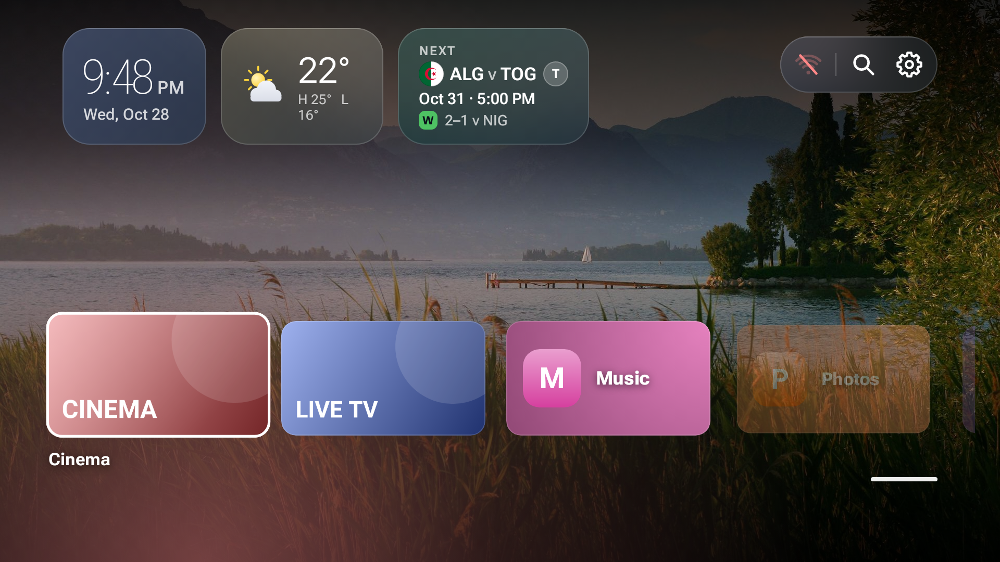
</p>

## Highlights

- **Just your apps.** The home screen shows only your favourites; everything else waits one press below, in an alphabetical grid that turns over a page at a time.
- **Widgets you choose.** Up to four frosted-glass cards across the top: clock, weather, sunrise & sunset, system info, and a tracker for Algeria's national team (Les Fennecs) with the next fixture and the latest result.
- **Built for the remote.** Focused apps lift and get a crisp white ring, every move animates smoothly, and every action is one or two presses of the D-pad.
- **A fresh view.** The background cross-fades between full-screen photos, and the next one is loaded before it appears, so it never flashes.
- **Light on the TV.** One small app, written in Jetpack Compose, with no background services and no tracking.

## Screenshots

<table>
  <tr>
    <td width="50%">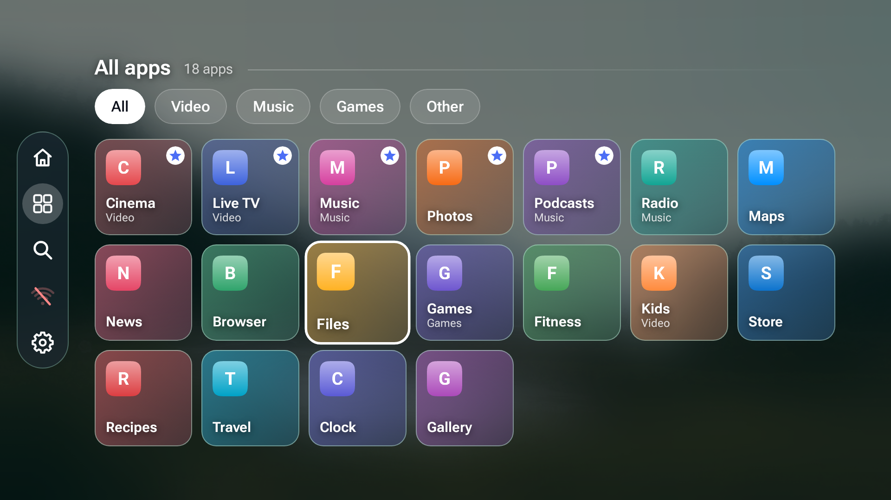<br><sub><b>All apps</b>: press down and the grid slides up a page at a time over a dimmed photo.</sub></td>
    <td width="50%">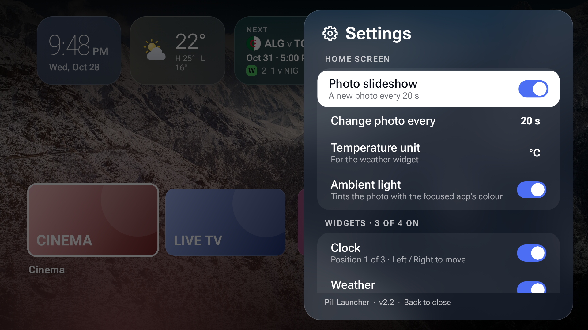<br><sub><b>Settings</b>: a floating card for the slideshow, the weather and the TV's own settings.</sub></td>
  </tr>
  <tr>
    <td width="50%">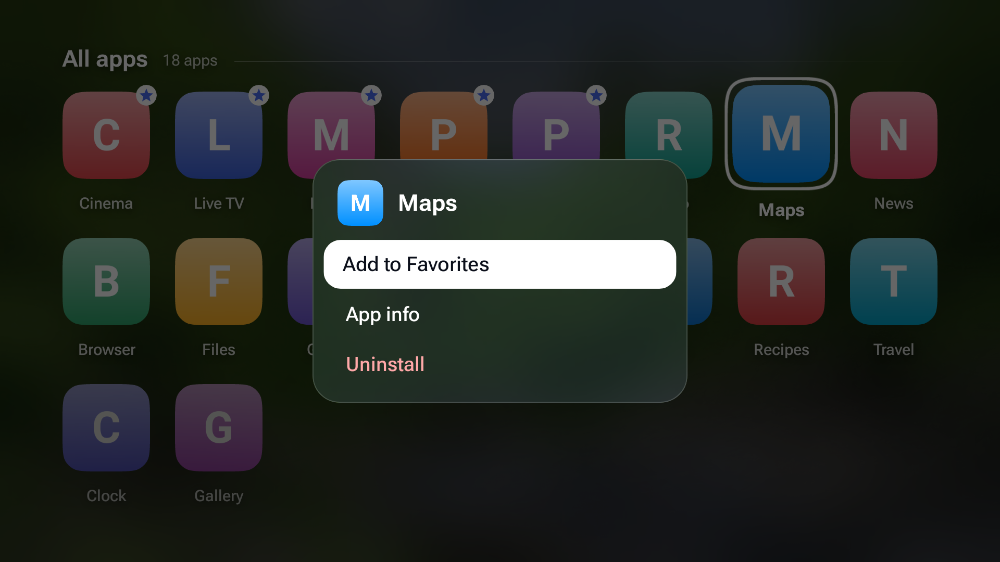<br><sub><b>App menu</b>: hold OK on any app to pin it, move it, see its info or uninstall it.</sub></td>
    <td width="50%">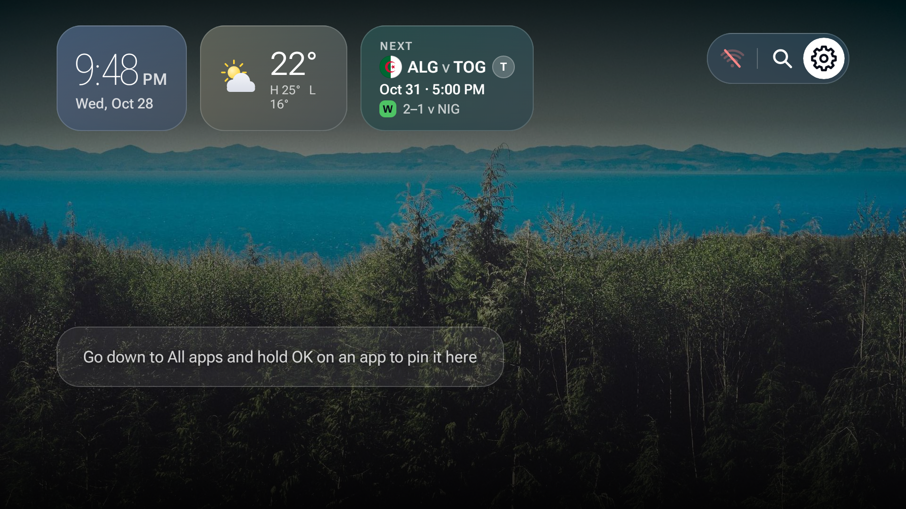<br><sub><b>First launch</b>: a hint shows how to fill Favorites.</sub></td>
  </tr>
</table>

<table>
  <tr>
    <td width="50%">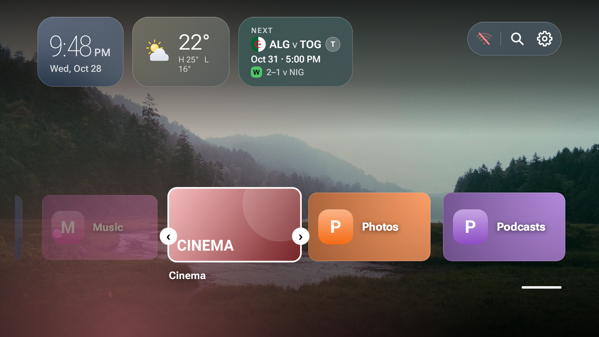<br><sub><b>Reorder favourites</b>: Move, then Left / Right, then OK.</sub></td>
    <td width="50%">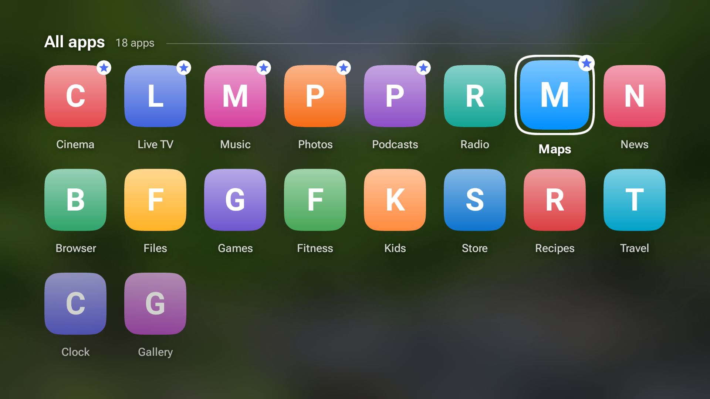<br><sub><b>Pinned</b>: a short confirmation, and the app joins Favorites.</sub></td>
  </tr>
</table>

<table>
  <tr>
    <td width="50%">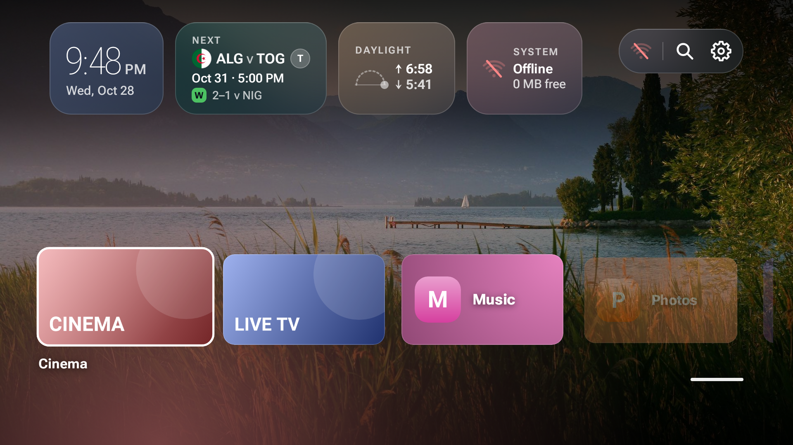<br><sub><b>Widgets</b>: up to four cards; with four on they switch to compact layouts.</sub></td>
    <td width="50%">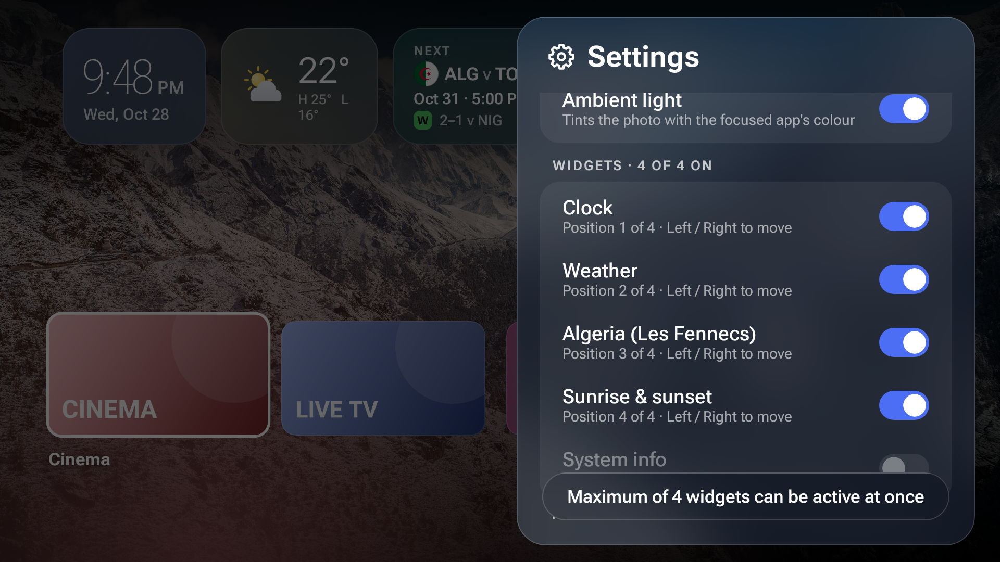<br><sub><b>Widget settings</b>: switch widgets on and off and move them with Left / Right.</sub></td>
  </tr>
</table>

<p align="center">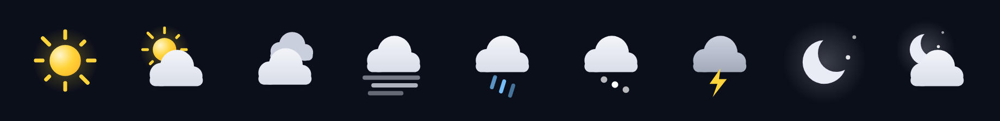</p>

<table>
  <tr>
    <td width="50%">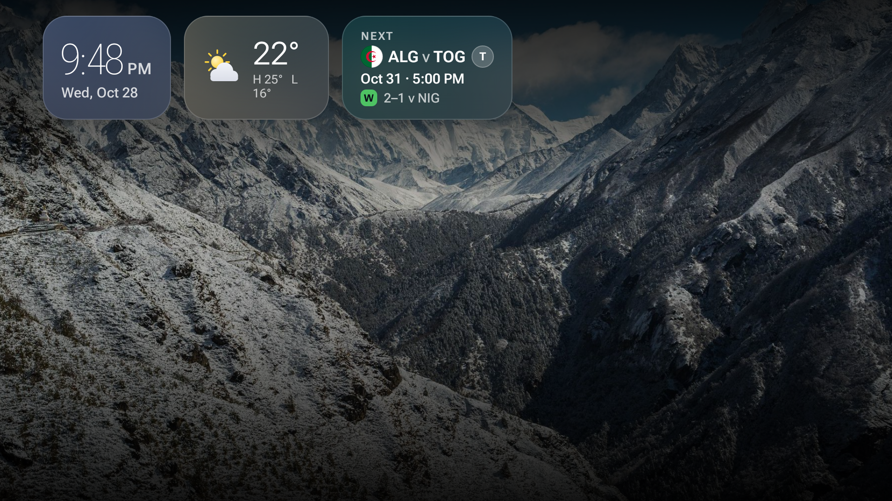<br><sub><b>Idle screen</b>: after a while without a key press, only the widgets stay.</sub></td>
    <td width="50%">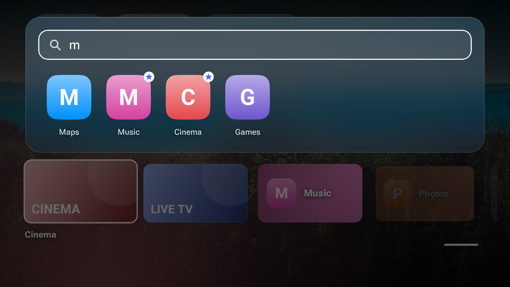<br><sub><b>Search</b>: find any app by name with the TV keyboard.</sub></td>
  </tr>
</table>

<sub>Screenshots are rendered at 1920×1080 from the app's own interface code by <code>.github/workflows/screenshots.yml</code>. The app names and icons in them are stand-ins; on your TV you'll see your installed apps. Photos: <a href="https://picsum.photos">Lorem Picsum</a> (Unsplash licence).</sub>

## Install

1. On the TV, install **Downloader** (by AFTVnews) from the Play Store.
2. Open it and enter `https://github.com/S1rHades/One-TVOS/releases/download/latest/launcher.apk`.
3. Allow Downloader to install unknown apps when Android asks, then choose **Install**.

To make it your home screen, open **Settings** (the gear) → **Default home screen**. Android asks you to confirm; after that, Home and closing or killing any app bring you back to Pill Launcher.

Many TVs, most Google TV devices among them, don't let any app replace the home screen. On those, use **Settings → Home button helper**: it opens Accessibility settings, where you turn on **Pill Launcher Home button**. Whenever the TV's own home screen opens (Home pressed, an app closed or killed), the helper brings Pill Launcher straight back. It only checks which app came to the front, never what is on screen. On Android 13 and later, a sideloaded app's accessibility switch may be greyed out at first: open **Settings → Apps → Pill Launcher**, choose **⋮ → Allow restricted settings**, then turn it on.

The `latest` release is rebuilt automatically every time `main` changes, so installing it again always gets you the newest version.

## Using it

| To | Press |
| --- | --- |
| Open an app | **OK** |
| See all apps | **Down** from Favorites |
| Find an app | The magnifier (top right), then type |
| Open Wi-Fi settings | The connection icon (top right, left of the magnifier), then **OK** |
| See if a VPN is on | A green key shows beside the connection icon |
| Change how favourites are laid out | **Settings → Favorites row → Layout**: Scroll or Wrap |
| Banners or icons for favourites | **Settings → Favorites row → Tile style** |
| Wake the idle screen | Any key |
| App menu: pin / unpin, move, app info, uninstall | Hold **OK** for half a second, or press **Menu** (☰) |
| Reorder favourites | App menu → **Move**, then **Left** / **Right**, and **OK** when done |
| Open settings | Go up to the round gear button (top right), then **OK** |
| Change how often the photo changes, or the weather unit | In settings, **Left** / **Right** on that row |
| Turn widgets on or off | **Settings → Widgets**, **OK** on a widget (up to four at once) |
| Reorder widgets | **Settings → Widgets**, **Left** / **Right** on a widget that's on |
| Close settings | **Back** |

Settings and favourites are saved on the TV and survive restarts and updates.

### Weather

The widget finds the TV's approximate location from its internet address with [GeoJS](https://www.geojs.io/) and gets the forecast from [Open-Meteo](https://open-meteo.com/), or from [MET Norway](https://api.met.no/) if Open-Meteo can't be reached. None of them needs an account or key. It refreshes every 30 minutes. Choose °C or °F in settings. Turn off both the Weather and the Sunrise & sunset widgets, and the launcher contacts none of these services. If the weather can't load, Settings shows why under the Weather widget's row. Sunrise and sunset are worked out on the TV from the same location.

### Les Fennecs (Algeria)

The Algeria widget shows the men's national team's next fixture (competition, crests and kick-off in the TV's time zone) and the latest result, marked W, D or L. During a match it shows **LIVE** and the score. The data comes from [TheSportsDB](https://www.thesportsdb.com/)'s free API, with no account needed. If a TV can't reach TheSportsDB, it reads a copy that the **Fixtures mirror** workflow (`.github/workflows/fixtures.yml`) refreshes every 30 minutes on the `fixtures-data` branch. It refreshes every 30 minutes, and every 3 minutes around a match. The last good copy is saved on the TV, so the widget still has something to show when the TV is offline.

### Your own photos

The twelve nature photos are built into the app (`app/src/main/assets/photos`), so they show even without internet. To change them, edit the Lorem Picsum ids in `BackgroundSources` (`app/src/main/java/app/pill/launcher/ui/BackgroundSlideshow.kt`) and in `.github/workflows/photos.yml`, then run the **Bundle photos** workflow. `BackgroundSources` also accepts direct `https://` image links.

## Development

You need JDK 17 and the Android SDK (API 34). Android Studio works, or from the command line:

```
gradle assembleDebug                                   # app/build/outputs/apk/debug/app-debug.apk
gradle :app:testDebugUnitTest --tests '*Screenshots*'  # re-render docs/screenshots
```

**Builds are automated.** `.github/workflows/build.yml` builds the APK for every pull request and push; builds of `main` replace the `latest` release. `.github/workflows/screenshots.yml` re-renders the README screenshots at 1920×1080 and commits them; run it from the Actions tab after changing the interface.

<details>
<summary><b>Architecture</b></summary>

```
app/src/main/java/app/pill/launcher/
  MainActivity.kt        launcher activity: loads apps, opens them, keeps pins and settings
  AppModel.kt            lists launchable apps (TV apps first) with their icons
  LauncherSettings.kt    settings and pinned apps in SharedPreferences
  Weather.kt             location and forecast lookup, condition names and units
  Widgets.kt             the widget kinds, the four-widget limit, toggling and reordering
  Fixtures.kt            Algeria's fixtures from TheSportsDB, with an offline copy
  Daylight.kt            sunrise and sunset from latitude and longitude
  ui/
    LauncherScreen.kt    the home screen: a first page with the clock and favourites, All apps below, page scrolling
    AppTile.kt           a focusable squircle app tile
    BackgroundSlideshow.kt  photo cross-fade and the readability scrim
    SettingsPanel.kt     the floating settings card (its own dialog window, so focus stays inside)
    SettingsPill.kt      the round gear button and the gear icon
    WidgetCards.kt       the header's glass widget cards and their row
    WeatherWidget.kt     the weather card's content, with drawn condition icons
    Theme.kt             shared colours and spacing
    Squircle.kt          the superellipse tile shape
app/src/test/.../Screenshots.kt   Robolectric + Roborazzi renders for this README
```

The screen is laid out in dp for a 960×540 dp canvas (a 1080p TV at xhdpi), with 48 dp and 27 dp margins to stay inside the overscan-safe area.

</details>
