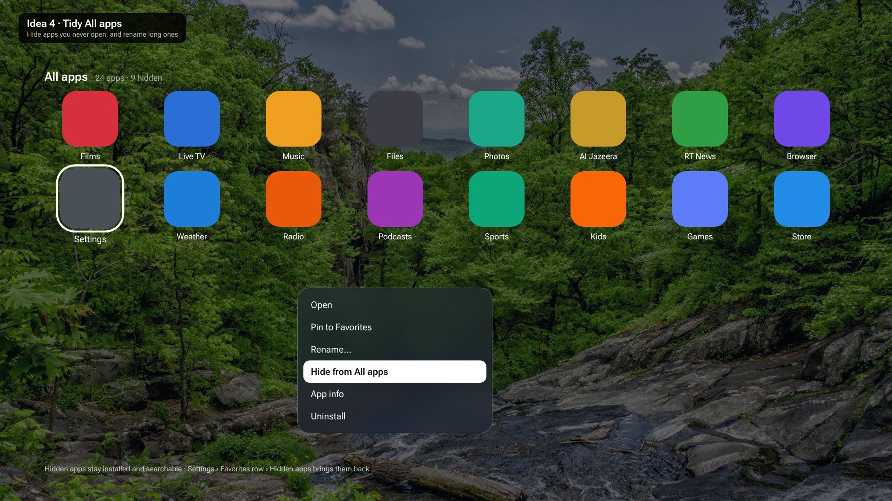
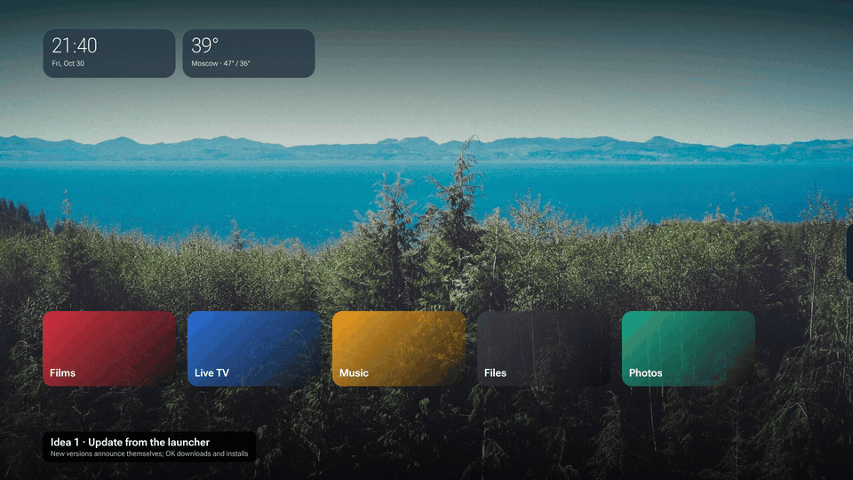
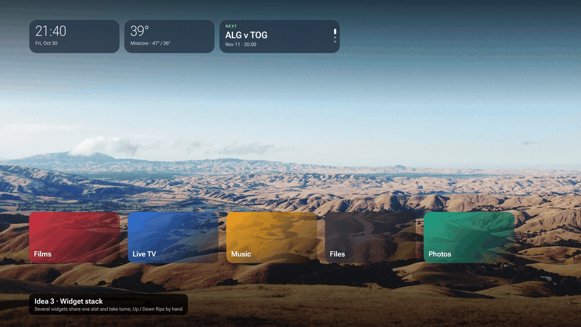
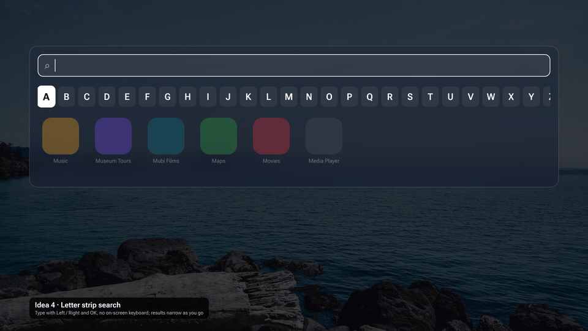
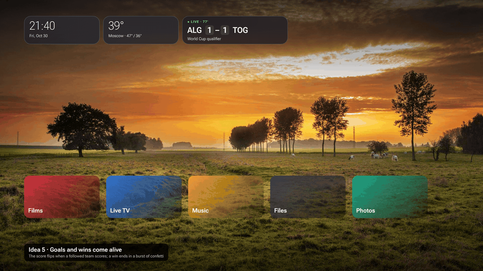
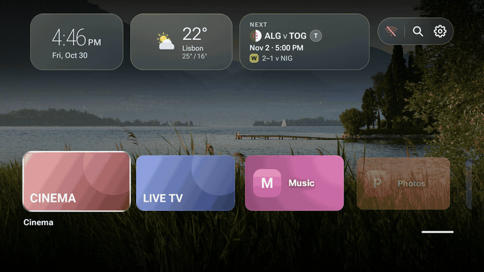

# Planned features

Chosen for a future release; not built yet. The pictures are mockups, so the finished
screens may differ in detail.

## 1. Tidy All apps

- The app menu gets **Hide from All apps** and **Rename…**.
- Hidden apps stay installed and still show in search. **Settings → Favorites row → Hidden apps** brings them back.
- Names are only changed in the launcher; the app itself is untouched.

## 2. Update from the launcher

- When a newer release is on GitHub, a card slides in: "Pill Launcher 2.9 is ready".
- OK downloads the versioned APK (`pill-launcher-<version>.apk`) with a progress bar. Android then asks to confirm the install.
- Settings and favourites are kept, because each update is signed with the same key.
- Needs the "install unknown apps" permission for Pill Launcher; it asks the first time.

## 3. Widget stack

- One widget slot holds several widgets that take turns, sliding up to the next every few seconds (for example football, headlines, sunset).
- Dots at the side show which is showing. Up / Down flips by hand while the slot has focus.
- More widgets fit without crowding the row (still at most four slots).

## 4. Letter strip search

- Search without the on-screen keyboard: Left / Right moves along a strip of letters, OK adds one, and the results narrow as you type.
- The TV keyboard stays available for those who prefer it.

## 5. Goals and wins come alive

- When a followed team's score goes up, the number flips and the football card flashes green ("Goal · Algeria 78'").
- A win ends at full time in a short burst of confetti from the card.
- The free football data refreshes every few minutes during a match, so the flip comes a little after the real goal.
- Gentle and short, and nothing moves on the idle screen.

## 6. Glass motion across the launcher

Built from the real home and forecast screens: OK on the weather card, then Back.

The motion in the reference video comes down to four moves. They become the launcher's only way of moving:

1. **Dissolve.** Things arrive frosted and come into focus: blurred, see-through and a few dp low, then sharp and in place. They leave the same way, faster.
2. **Wave.** A group never appears all at once. It comes in reading order (left to right, top to bottom), one step at a time, so the eye follows it across the screen.
3. **Rack focus.** When one screen gives way to another, the photo goes soft for a moment, as a camera does when it changes focus, then sharpens behind the new screen.
4. **Glide.** A selection marker slides from item to item instead of jumping: the Settings highlight, the football team tabs, the page dots, and later the letter strip.

**Where it goes**

| Place | With glass motion |
| --- | --- |
| Waking from idle | Widgets, then favourites, wave in; the photo refocuses |
| Going idle | Reverse wave; the photo stays sharp, as it's the show |
| Forecast, clock, football and headline pages | Photo racks focus; the page dissolves in, section by section; Back reverses it |
| Settings | Rows wave in from the side you moved towards; the highlight glides |
| All apps and search | Tiles wave in diagonally, row by row |
| Widget content (football card turns, headlines) | The old content dissolves out, the new one in |
| App menu, prompts and the planned update card | Dissolve in where they open |
| Weather icons and the photo slideshow | Unchanged: they already have their own slow motion |

**How it stays consistent**

Right now the launcher moves with 25 different durations, hand-picked in 18 files. The plan replaces them with one small set:

- **One file, `ui/Motion.kt`, holds every number.** There are four durations: Quick 200 ms, Exit 280 ms, Enter 450 ms and Page 600 ms. There are two curves: the existing `WakeEasing` for things arriving, and one accelerating curve for things leaving. The wave step is 50 ms, capped at 8 steps, so a long list never waits. The dissolve uses 12 dp of blur and 8 dp of rise. Nothing else in the code writes its own `tween(…)`.
- **Three building blocks, used everywhere:**
  - `Modifier.dissolve(visible, step)` for anything that comes or goes;
  - `rememberWave(count)` for the reading-order delays;
  - `Modifier.glide(...)` for the selection marker.
- **One switch for all motion.** `OverlayPage` is the shared frame for the forecast, clock, football and headline pages, so changing it once covers all four. The home screen, Settings and All apps call the same building blocks.
- **Smooth on a TV.**
  - Only opacity, position, scale and blur are animated, so layouts never recalculate mid-animation.
  - At most about ten things are blurred at once.
  - Blur needs Android 12 or newer. Older TVs still get the fade, rise and wave, just without the frost. The photo's soft focus uses a small pre-blurred copy of the photo, so it works on every version and costs almost nothing.
- **Respects the TV's settings.** It follows Android's animation speed setting, and turning animations off there turns them off here too. A new **Settings → Idle screen → Motion: Full / Calm** option keeps the fades but drops the blur and the wave.
- **Tested so it can't drift.**
  - A unit test checks the wave order and the cap.
  - A screenshot test catches each page half-way through its entrance, so a change that breaks the motion shows up as a picture.
  - A check fails the build if a raw `tween(` appears outside `Motion.kt`.

**Order of work**

1. `Motion.kt`, the three building blocks, the Motion setting and the tests.
2. `OverlayPage`, which covers the forecast, clock, football and headline pages, plus the photo's rack focus.
3. Waking from idle and going idle.
4. Settings, with its gliding highlight, then the football tabs and page dots.
5. All apps, search, the app menu and widget content changes.

The other planned features (widget stack, letter strip search, update card) would use the same building blocks from the start.

## Not chosen

Ideas shown as mockups and passed over, so they aren't suggested again:

- Send to TV from your phone
- App folders on the Favorites row
- Jump back in row
- Rain-soon alerts
- World clocks widget
- Air quality
- App lock with PIN
- Exchange rates widget
- Plasma care
- Morning briefing
- Number-key shortcuts
- Photo info
- Moon phases
- Now playing widget
- Sleep timer
- Prayer times
- Occasions and countdowns
- Photo themes
- Idle clock styles
- Network speed test
- Rain radar
- Results over any app
- Your own photos (USB)
- Pill Launcher as the screensaver
- Live weather on the photo
- Contextual dimming
- Unslop design pass (flatter, greyer, thinner restyle; read as a downgrade on the TV)
