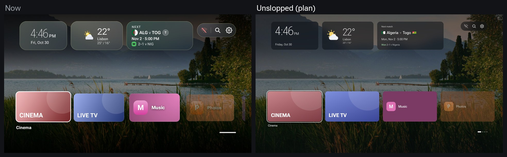
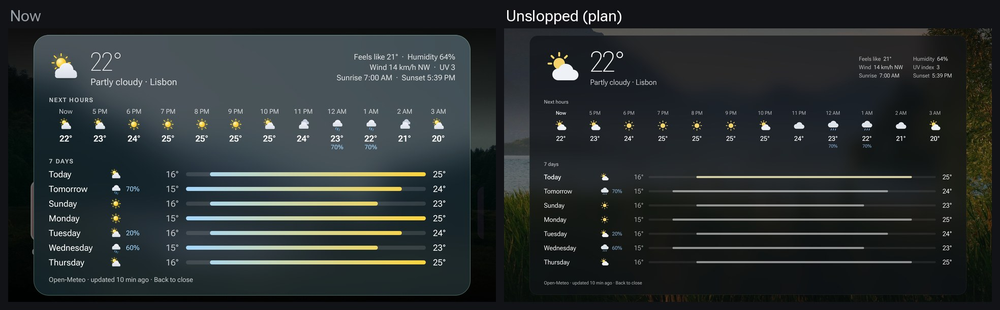
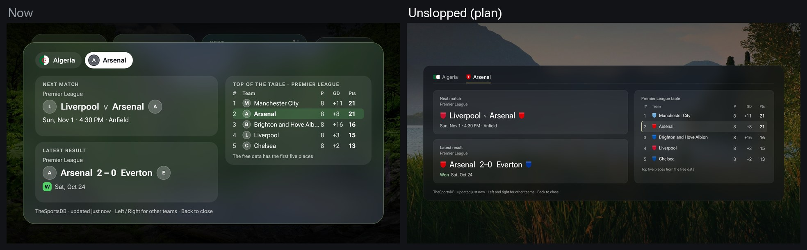
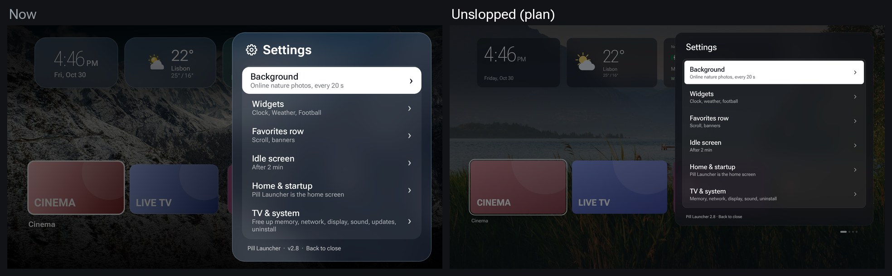

# Planned features

Chosen for a future release; not built yet. The pictures are mockups, so the finished
screens may differ in detail.

## 1. Tidy All apps

- The app menu gets **Hide from All apps** and **Rename…**.
- Hidden apps stay installed and still show in search. **Settings → Favorites row → Hidden apps** brings them back.
- Names are only changed in the launcher; the app itself is untouched.

## 2. Update from the launcher

- When a newer release is on GitHub, a card slides in: "Pill Launcher 2.9 is ready".
- OK downloads the versioned APK (`pill-launcher-<version>.apk`) with a progress bar. Android then asks to confirm the install.
- Settings and favourites are kept, because each update is signed with the same key.
- Needs the "install unknown apps" permission for Pill Launcher; it asks the first time.

## 3. Widget stack

- One widget slot holds several widgets that take turns, sliding up to the next every few seconds (for example football, headlines, sunset).
- Dots at the side show which is showing. Up / Down flips by hand while the slot has focus.
- More widgets fit without crowding the row (still at most four slots).

## 4. Letter strip search

- Search without the on-screen keyboard: Left / Right moves along a strip of letters, OK adds one, and the results narrow as you type.
- The TV keyboard stays available for those who prefer it.

## 5. Goals and wins come alive

- When a followed team's score goes up, the number flips and the football card flashes green ("Goal · Algeria 78'").
- A win ends at full time in a short burst of confetti from the card.
- The free football data refreshes every few minutes during a match, so the flip comes a little after the real goal.
- Gentle and short, and nothing moves on the idle screen.

## 6. Unslop pass: a quieter, more deliberate look

A design pass with [unslop](https://heydamir.design/unslop) (by Damir Sokolovsky, CC BY 4.0).
Left is the launcher today, right is the plan. Same features, same layout, same photo.

**Direction**
- Product: the home screen of one living-room TV: apps, the time, the weather and your teams, over a nature photo.
- Character: calm, readable from the sofa, a little warm.
- World: an evening window. The photo is the light; everything else is smoked glass in front of it.
- Moments: the photo itself, the forecast's temperature ranges, the next match with real crests and flags.
- Signature: the accent is sampled from the current photo and used once per screen (today's bar, the selected team, the table row).

**What the audit found, and the fix**
- Uppercase, tracked labels ("NEXT MATCH", "7 DAYS", "TOP OF THE TABLE") → sentence case at normal tracking (`CardLabel` in `WidgetCards.kt`, `PageLabel` in `Overlay.kt`, `SettingsPanel.kt`).
- Glass with a tinted edge, a colour wash and a coloured glow under focused tiles → one smoked surface with a faint hairline; the focused tile keeps its white ring and gets a neutral shadow (`glass()` in `Glass.kt`, `WidgetCards.kt`, `AppTile.kt`, `BannerTile.kt`).
- Every forecast bar is a blue-to-yellow gradient → neutral bars on one track, today's bar in the photo's accent (`ForecastPage.kt`).
- Bold 700–750 weights mixed with thin numbers → weights 400–500, hierarchy from size; tabular figures for every time, temperature and score.
- Letter circles standing in for crests, and a green "W" pill → the team's crest (a flat shield when none loads) and the word "Won" in muted green.
- Settings title with a gear icon and a row subtitle that wraps → plain title, one-line subtitles.
- Generated banners use a radial glow and a white sheen when focused → a flat colour from the app's icon; the name in medium weight.
- Kept on purpose: the moving weather icons from 2.8, the strong white focus (it's what reads from across the room), and apps' own banners (Cinema, Live TV) as their apps draw them.

## Not chosen

Ideas shown as mockups and passed over, so they aren't suggested again:

- Send to TV from your phone
- App folders on the Favorites row
- Jump back in row
- Rain-soon alerts
- World clocks widget
- Air quality
- App lock with PIN
- Exchange rates widget
- Plasma care
- Morning briefing
- Number-key shortcuts
- Photo info
- Moon phases
- Now playing widget
- Sleep timer
- Prayer times
- Occasions and countdowns
- Photo themes
- Idle clock styles
- Network speed test
- Rain radar
- Results over any app
- Your own photos (USB)
- Pill Launcher as the screensaver
- Live weather on the photo
- Contextual dimming
